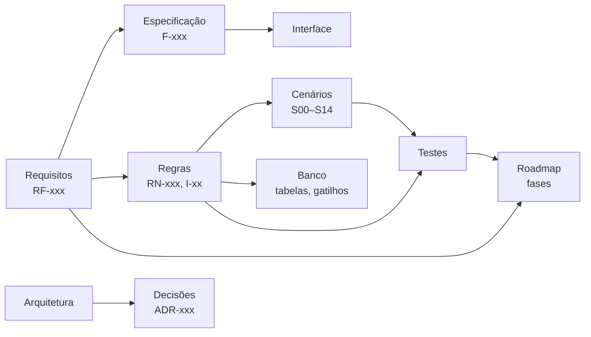

# Sistema de Gestão Financeira Pessoal — Projeto

| Campo | Valor |
|---|---|
| Data | 06/11/2026 |
| Etapa atual | 7 — Revisão (projeto completo apresentado para avaliação) |
| Próxima etapa | 8 — Aprovação: a implementação só começa quando o usuário escrever `AUTORIZO O DESENVOLVIMENTO` |

---

## 1. O que é

Sistema pessoal para controlar contas, cartões, contas a pagar, receitas, dívidas, valores a receber, reservas e metas. Ele roda no PC do usuário, e o celular acessa pelo Tailscale. Três compromissos:
- todo número vem de um registro central (Livro-Razão) e pode ser rastreado até a origem;
- lançar um gasto no celular leva segundos;
- operação simples e sem custo mensal.

## 2. Documentos

Ordem sugerida de leitura:

| # | Documento | Responde a | Versão e status |
|---|---|---|---|
| 1 | [product-requirements.md](product-requirements.md) | O que o sistema faz, para quem, em que ordem; glossário; MVP-1 a MVP-6 | 0.2, aprovado |
| 2 | [business-rules.md](business-rules.md) | Como cada operação afeta saldos, faturas e relatórios; fórmulas; invariantes | 0.2, aprovado (detalhes da Fase 2A em §22) |
| 3 | [reference-scenarios.md](reference-scenarios.md) | Exemplos com resultados exatos ao centavo (S00–S14) | 0.1, aprovado |
| 4 | [functional-specification.md](functional-specification.md) | O que cada tela e ação faz (F-001 a F-100) | 0.1, aprovado |
| 5 | [ui-ux-specification.md](ui-ux-specification.md) | Visual, cores, tipografia, navegação, componentes, esboços | 0.1, aprovado |
| 6 | [architecture.md](architecture.md) | Tecnologias escolhidas e por quê; modelo do Ledger; backup; segurança técnica | 0.2, aprovado |
| 7 | [database-design.md](database-design.md) | Tabelas, restrições e gatilhos de integridade | 0.4, aprovado (detalhes da Fase 2A em §15) |
| 8 | [security-plan.md](security-plan.md) | Ameaças, controles, backup e restauração, resposta a incidentes | 0.3, aprovado (ajustes das Fases 1D e 2A em §13) |
| 9 | [testing-plan.md](testing-plan.md) | Como cada regra é testada; critérios de aprovação de cada entrega | 0.1, aprovado |
| 10 | [implementation-roadmap.md](implementation-roadmap.md) | Fases, tarefas, arquivos, dependências, mapa de módulos | 0.3 (ver §8) |
| 11 | [decisions.md](decisions.md) | 40 decisões com alternativas e justificativas (ADR-001 a 040) | 0.5, aprovado (ADR-040: estudo de design antes da Fase 6) |

## 3. Resumo das decisões principais

| Tema | Decisão | ADR |
|---|---|---|
| Fonte da verdade | Livro-Razão de partidas dobradas; só ele grava valores | 001 |
| Dinheiro | Inteiros em centavos; taxas em decimal exato; arredondamento meio para cima | 002, 026 |
| Correções | Nada é excluído: previstos cancelados, confirmados estornados (técnico ou comercial) | 003, 033 |
| Compromissos | Liquidados por pagamentos novos, nunca "confirmados" | 032 |
| Cartões | Gasto no mês da compra; visão por parcela no mês da fatura; faturas como alocação | 004, 005, 034 |
| Saldos | Bancário, comprometido até o próximo salário recebido, disponível, projetado, sem sobreposição | 006, 036 |
| Valores a receber | No MVP; nunca viram receita | 007 |
| Entregas | Seis entregas com portas de validação; cartões antes de dívidas | 009, 010 |
| Tecnologia | Python + Django, SQLite, htmx + Alpine.js + Tailwind, ECharts | 013–016 |
| Execução | Serviço do Windows (WinSW + Waitress), agendador interno | 011, 017, 018 |
| Acesso remoto | Tailscale Serve com HTTPS, servidor só em 127.0.0.1 | 012 |
| Login | Senha Argon2id + PIN em aparelho confiável por 30 dias; bloqueio de tentativas | 019, 035 |
| Backup | Diário, verificado, criptografado com `age`, local + nuvem, versões, teste mensal | 021 |
| Alertas | Telegram com nome e valor | 029 |

## 4. Rastreabilidade

Cada identificador citado em qualquer documento existe no documento de origem. Isso foi verificado automaticamente na revisão (§5).

## 5. Revisão da Etapa 7

### 5.1 Verificações feitas

| Verificação | Resultado |
|---|---|
| Toda referência RF, RN, I, T, F, S e ADR aponta para um item definido | OK, nenhuma referência quebrada |
| Todo requisito RF está numa fase do roadmap (§7 do roadmap) | OK |
| Todo cenário tem arquivo de teste e entrega a partir da qual é obrigatório | OK |
| Valores dos cenários recalculados com aritmética decimal exata | OK: Price (S09), rateios (S01), mês combinado e equação patrimonial (S14) |
| 5º dia útil de 2026 e 2027 recalculado com feriados de São Paulo e Carnaval | OK (`testing-plan.md` §8) |
| Decisões tomadas pelo usuário refletidas nos documentos (P-01 a P-07 e Fase B) | OK |
| Mudanças em documentos já aprovados registradas em seções de alterações e ADRs substitutas | OK (`product-requirements.md` §14, `architecture.md` §14, ADR-035, ADR-036) |
| Nenhum arquivo de código criado | OK (só `.md` em `docs/`) |

### 5.2 Inconsistências encontradas e corrigidas

| # | Problema | Correção |
|---|---|---|
| R-01 | "Quanto pagar em 7/15/30 dias" apontava para o saldo comprometido, que tem horizonte fixo (H) | Aponta para a projeção (RN-150) |
| R-02 | Glossário do comprometido total incluía recorrências sem fim, ao contrário da RN-144 | Glossário alinhado |
| R-03 | Glossário do projetado sem retiradas planejadas e sem a regra de atrasados | Alinhado à RN-146 |
| R-04 | Arquitetura tratava parcela a receber como compromisso, ao contrário da ADR-034 | Corrigido |
| R-05 | Arquitetura citava vínculos "liquida" e "recebe", que no banco são tabelas próprias | Corrigido |
| R-06 | RN-162 permitia visão por parcela estimada antes do MVP-3, contrariando a ADR-005 | A visão existe a partir do MVP-3 |
| R-07 | Alertas de bloqueio e de backup prometidos no MVP-1, mas o Telegram só chega no MVP-2 | No sistema desde o MVP-1; no Telegram a partir do MVP-2 |
| R-08 | Exemplo de parcela na arquitetura com números diferentes do S09 | Alinhado ao S09 |

### 5.3 Pontos a confirmar no início da implementação

Não mudam o projeto, mas dependem do ambiente real:

| # | Ponto | Onde |
|---|---|---|
| C-01 | A conta do Windows tem senha utilizável pelo serviço? Se não, usar o plano B (tarefa ao fazer logon) | `architecture.md` §11 |
| C-02 | O PC suporta "Criptografia do dispositivo"? | ADR-022 |
| C-03 | Sintaxe exata do Tailscale Serve, do WinSW e do `age` nas versões instaladas | `security-plan.md` (nota inicial) |
| C-04 | Versões LTS vigentes do Python e do Django, fixadas no `uv.lock` | ADR-013 |
| C-05 | Regras de cada emissor de cartão (compra no dia do fechamento, resto de centavos, limite do parcelado) | `business-rules.md` RN-005, RN-070, RN-086 |

### 5.4 Riscos residuais aceitos

- O sistema depende do PC ligado e da sessão do Windows aberta, para a cópia na nuvem sincronizar.
- O Telegram vê nome e valor dos alertas (ADR-029).
- O PIN dá acesso por até 30 dias a quem tiver o celular desbloqueado (ADR-035).
- Perder a senha de backup torna os backups antigos ilegíveis (`security-plan.md` §10.5).

## 6. Como seguir

1. O usuário revisa o projeto e pede alterações, se quiser. Cada alteração atualiza todos os documentos afetados e é registrada.
2. Quando estiver de acordo, escreve exatamente: **AUTORIZO O DESENVOLVIMENTO**.
3. A implementação começa pela Fase 0 do roadmap e segue fase a fase. Cada fase termina com relatório e cada entrega com porta de validação aprovada pelo usuário.
