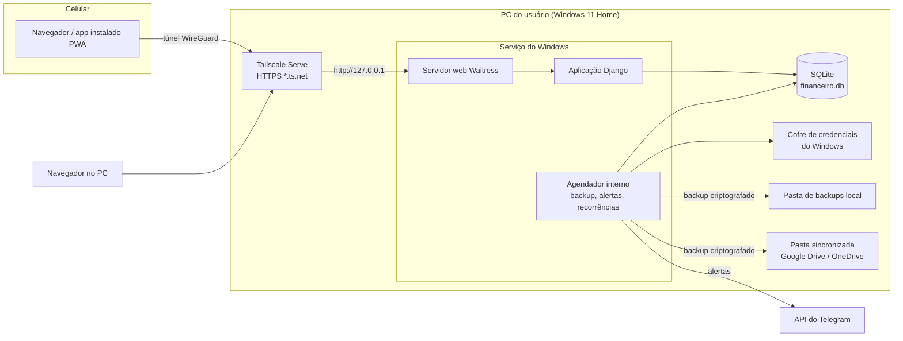
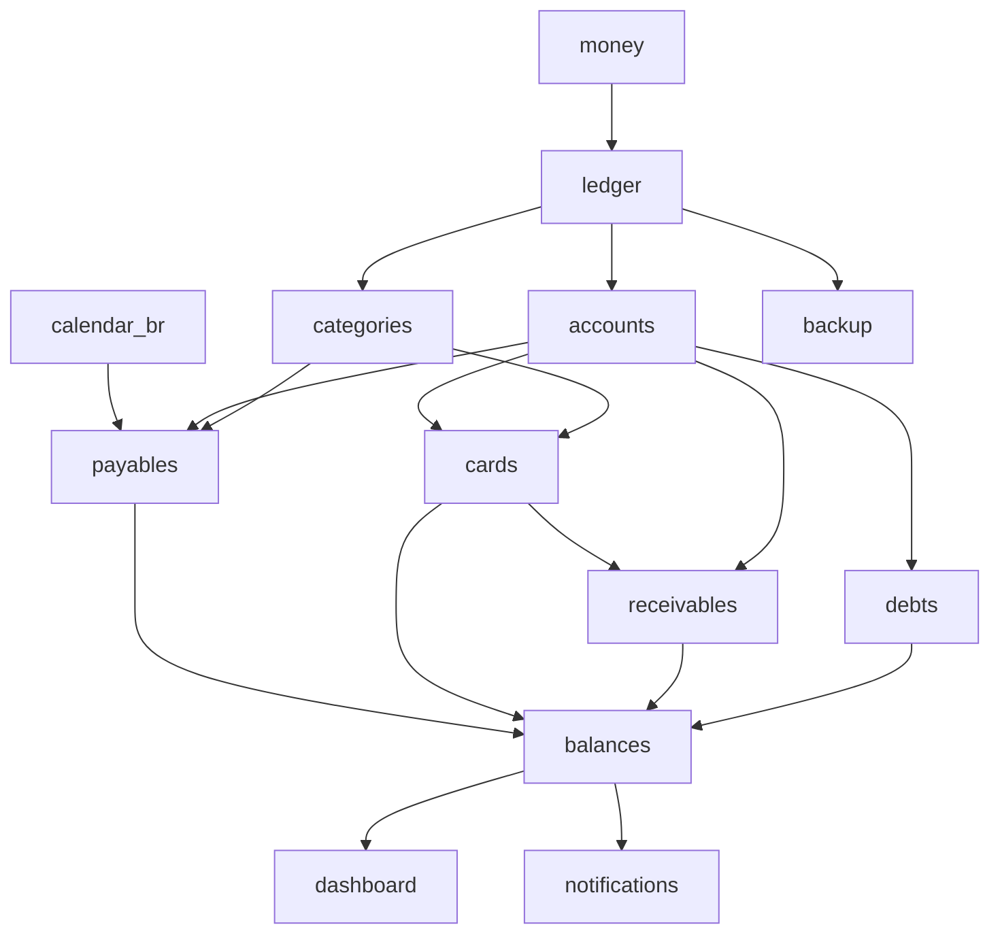
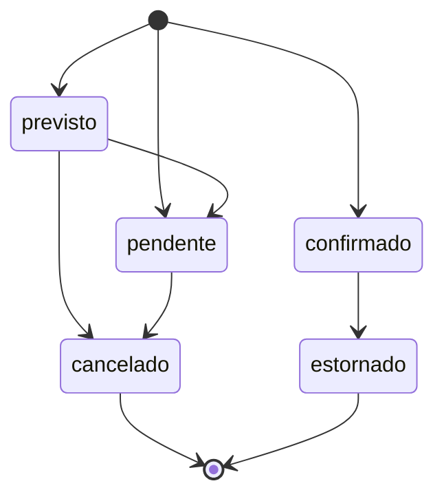

# Arquitetura Técnica — Sistema de Gestão Financeira Pessoal

| Campo | Valor |
|---|---|
| Versão | 0.2 |
| Data | 06/11/2026 |
| Etapa | 3 — Arquitetura (Fase A) |
| Status | Versão 0.1 aprovada em 06/11/2026; versão 0.2 com alterações da Fase B (§14), aprovada em 06/11/2026 |
| Documentos relacionados | `product-requirements.md`, `decisions.md` |

As decisões deste documento estão registradas, com alternativas e consequências, em `decisions.md` (identificadores ADR-xxx citados entre parênteses). Versões exatas das bibliotecas serão fixadas em arquivo de travamento (lockfile) no início da implementação, sempre na versão estável ou LTS vigente.

---

## 1. Requisitos que guiam a arquitetura

| Requisito | Origem |
|---|---|
| Uso individual, servidor no PC do usuário (Windows 11 Home) | Descoberta |
| Celular acessa de qualquer lugar via Tailscale, com HTTPS | Descoberta, ajuste de segurança |
| Lançamento rápido no celular | Descoberta |
| Ledger de partidas dobradas como fonte única da verdade | Requisito do Ledger |
| Precisão decimal exata; nada de ponto flutuante para dinheiro | Pedido original, RNF-01 |
| Transações ACID, atomicidade, idempotência, concorrência otimista | Requisito do Ledger |
| Backup automático, versionado, criptografado, verificado e testado | Ajuste de backup |
| Usuário com conhecimento intermediário; custo zero | Descoberta, RNF-09, RNF-10 |
| pt-BR, BRL, calendário de dias úteis com feriados de São Paulo | Pedido original, descoberta |

O critério de desempate entre alternativas é, nesta ordem: **confiabilidade dos cálculos → segurança → simplicidade de operação → facilidade de desenvolvimento → riqueza de interface**.

## 2. Visão geral

Aplicação web **monolítica**, num único processo, rodando como serviço do Windows no PC do usuário. O banco de dados é um arquivo local. O celular e o computador acessam pelo navegador, através do Tailscale, com HTTPS.

Por que monolito em processo único (ADR-011): um usuário, um PC, volume pequeno de dados. Separar frontend e backend, usar filas ou vários serviços só aumentaria o que precisa ser instalado, atualizado e monitorado, sem ganho real.

## 3. Pilha tecnológica recomendada

| Camada | Escolha | ADR |
|---|---|---|
| Linguagem | Python (versão estável vigente, 3.12 ou superior) | ADR-013 |
| Framework web | Django (versão LTS vigente) | ADR-013 |
| Banco de dados | SQLite em modo WAL | ADR-014 |
| ORM e migrações | ORM e migrações do Django | ADR-014 |
| Interface | HTML renderizado no servidor + htmx + Alpine.js + Tailwind CSS | ADR-015 |
| Gráficos | Apache ECharts, servido localmente | ADR-016 |
| Servidor web | Waitress | ADR-017 |
| Serviço do Windows | WinSW | ADR-017 |
| Tarefas agendadas | Agendador interno com registro de execuções e recuperação | ADR-018 |
| Autenticação | Autenticação do Django + Argon2id + django-axes + confiança de aparelho com PIN | ADR-019 |
| HTTPS e acesso remoto | Tailscale Serve (certificado `*.ts.net`) | ADR-012 |
| Segredos | Cofre de credenciais do Windows via biblioteca `keyring` | ADR-020 |
| Notificações | API de bots do Telegram, só envio | ADR-020 |
| Backup | API de backup do SQLite + compressão + criptografia `age` | ADR-021 |
| Testes | pytest, pytest-django, Hypothesis, Playwright | ADR-023 |
| Exportação | `csv` (biblioteca padrão), openpyxl, ReportLab (PDF, pós-MVP) | ADR-024 |
| Gerenciamento de ambiente | `uv` (instala Python e dependências travadas) | ADR-013 |

Todas as peças são software livre e gratuitas. Nenhuma depende de serviço pago.

## 4. Alternativas avaliadas

### 4.1 Backend (linguagem e framework)

| Opção | Prós | Contras | Veredito |
|---|---|---|---|
| **Python + Django** | Tipo `Decimal` exato nativo; ORM, migrações, autenticação, sessões, CSRF, proteção de formulários e admin prontos; `transaction.atomic`; ecossistema maduro; código legível para usuário intermediário | Dois "mundos" (Python no servidor, pouco JavaScript no navegador) | **Escolhido** |
| Python + FastAPI + SQLAlchemy | Leve, moderno, tipado | Autenticação, sessões, CSRF, admin e migrações precisam ser montados à parte; mais peças para errar em segurança | Rejeitado |
| TypeScript + Next.js / Node | Uma linguagem só; ótimo para interfaces ricas | Tipo `number` é ponto flutuante: exige disciplina e biblioteca decimal em todo cálculo; mais dependências e atualizações frequentes; mais difícil de manter para intermediário | Rejeitado |
| C# + ASP.NET Core | Tipo `decimal` nativo; serviço do Windows nativo; muito robusto | SDK pesado; curva maior; ecossistema de interface menos simples para este caso | Alternativa viável, não escolhida |
| Java + Spring | Robusto | Pesado e verboso para uso pessoal | Rejeitado |

### 4.2 Banco de dados

| Opção | Prós | Contras | Veredito |
|---|---|---|---|
| **SQLite** | Arquivo único; zero administração; ACID; chaves estrangeiras; gatilhos; API de backup online consistente; modo WAL permite leitura durante escrita | Não tem tipo decimal (resolvido guardando centavos como inteiro); um escritor por vez (irrelevante para um usuário) | **Escolhido** |
| PostgreSQL | Tipo `NUMERIC` exato; concorrência superior | Serviço extra para instalar, atualizar e fazer backup; mais trabalho operacional sem benefício para um usuário | Rejeitado |
| Arquivos JSON / planilha | Simples | Sem transações, sem integridade, alto risco de corrupção | Rejeitado |

### 4.3 ORM

| Opção | Veredito |
|---|---|
| **ORM do Django** | Integrado a migrações, formulários, admin e testes. **Escolhido.** |
| SQLAlchemy | Mais poderoso em consultas complexas, mas exigiria abandonar parte do Django. Consultas de agregação do Ledger cabem no ORM do Django; SQL direto pode ser usado pontualmente em relatórios. |

### 4.4 Frontend e biblioteca de interface

| Opção | Prós | Contras | Veredito |
|---|---|---|---|
| **HTML no servidor + htmx + Alpine.js + Tailwind** | Uma aplicação só; quase nenhum JavaScript para manter; telas rápidas no celular; formulários validados no servidor; Tailwind gera visual moderno com CLI própria, sem Node | Interações muito complexas (arrastar e soltar elaborado) dão mais trabalho | **Escolhido** |
| SPA (React, Vue, Svelte) + API | Interface muito rica | Dois projetos, API, build com Node, estado duplicado no navegador, mais superfície de ataque, mais manutenção | Rejeitado |
| Templates Django puros, sem htmx | Mais simples ainda | Recarrega a página inteira a cada ação; pior no celular | Rejeitado |

Componentes de interface: conjunto próprio de componentes em Tailwind (cartões de indicador, tabelas, formulários, alertas, modais), definido em `ui-ux-specification.md` (Fase B). Ícones Lucide (SVG local). Fonte Inter com algarismos tabulares, servida localmente. Nada é carregado de CDN externa (RNF-08).

### 4.5 Gráficos

| Opção | Prós | Contras | Veredito |
|---|---|---|---|
| **Apache ECharts** | Muitos tipos (linhas, barras, pizza, calendário de calor para vencimentos); tema escuro; responsivo; local pt-BR | Biblioteca maior | **Escolhido** |
| Chart.js | Leve e simples | Menos tipos e menos controle de interação | Alternativa |
| Plotly | Poderoso | Pesado, visual menos "SaaS" | Rejeitado |

### 4.6 Autenticação

| Opção | Veredito |
|---|---|
| **Autenticação do Django + Argon2id + django-axes + PIN por aparelho** | Senha com hash Argon2id; bloqueio progressivo de tentativas; sessões no banco; PIN próprio por aparelho confiável. **Escolhido.** |
| Senha + TOTP (app autenticador) | Mais forte, mas o usuário escolheu PIN. Fica como opção pós-MVP, ativável nas configurações. |
| Passkeys / WebAuthn (biometria) | Muito seguro e cômodo; exige HTTPS (já previsto). Avaliar no pós-MVP como alternativa ao PIN para "biometria". |
| Provedor externo (Google, Auth0) | Rejeitado: depende de internet e de terceiros para entrar no próprio sistema local. |

### 4.7 Execução no Windows

| Opção | Veredito |
|---|---|
| **Waitress + WinSW** | Waitress é servidor web Python puro, estável no Windows. WinSW transforma o comando em serviço do Windows, com reinício automático e logs. **Escolhido.** |
| Uvicorn / Gunicorn | Gunicorn não roda no Windows; Uvicorn exige ASGI e não traz ganho aqui. |
| NSSM | Funciona, mas o projeto tem manutenção irregular. |
| Agendador de Tarefas do Windows "ao iniciar" | Sem reinício automático em falha; fica como plano B. |

### 4.8 Tarefas agendadas

| Opção | Veredito |
|---|---|
| **Agendador dentro do serviço, com tabela de execuções** | Um só processo para instalar. Cada tarefa grava sua última execução; ao iniciar, o serviço roda as que ficaram para trás (ex.: PC desligado na hora do backup). Tarefas são idempotentes. **Escolhido.** |
| Agendador de Tarefas do Windows chamando comandos | Mais uma configuração para manter e depurar. Plano B. |
| Celery / Redis | Exagerado para uso pessoal. Rejeitado. |

### 4.9 Testes

| Ferramenta | Uso |
|---|---|
| **pytest + pytest-django** | Testes de unidade e integração. |
| **Hypothesis** | Testes por propriedades: gera milhares de sequências aleatórias de operações e verifica que as invariantes do Ledger nunca quebram. |
| **Cenários de referência** | Cada cenário de `reference-scenarios.md` (Fase B) vira teste parametrizado com resultado exato em centavos. |
| **Playwright (Python)** | Testes de ponta a ponta dos fluxos principais, inclusive em tela de celular. |
| **time-machine** | Congela datas para testar vencimentos, dias úteis e recorrências. |
| **coverage** | Mede cobertura; o núcleo do Ledger e os cálculos exigem cobertura alta (meta em `testing-plan.md`). |

### 4.10 Backup

| Opção | Veredito |
|---|---|
| **API de backup do SQLite → verificação → compressão → `age`** | Cópia consistente com o banco em uso; `age` é formato de criptografia moderno e auditado, com ferramenta de linha de comando independente: dá para restaurar mesmo sem o sistema instalado. **Escolhido.** |
| Copiar o arquivo `.db` | Rejeitado: cópia de arquivo em uso pode sair corrompida. |
| ZIP com senha | Rejeitado: criptografia fraca ou de implementação variável. |
| Criptografia própria (AES manual) | Rejeitado: risco de erro de implementação. |

### 4.11 Exportação

| Formato | Escolha | Observação |
|---|---|---|
| CSV | Biblioteca padrão `csv` | UTF-8 com BOM, separador `;`, decimal com vírgula: abre certo no Excel em pt-BR. |
| Excel | openpyxl | Valores numéricos reais com formato de moeda. |
| PDF | ReportLab (pós-MVP) | Funciona no Windows sem dependências de sistema. WeasyPrint foi descartado porque exige bibliotecas GTK no Windows. Reavaliar na fase de relatórios. |

## 5. Organização do código (módulos)

Organização em aplicações Django por domínio. A estrutura de pastas detalhada vai para `implementation-roadmap.md` (Fase B).

| Módulo | Responsabilidade | Pode escrever no Ledger? |
|---|---|---|
| `ledger` | Contas contábeis, transações, pernas, estados, estornos, idempotência, auditoria, invariantes, saldos | **Sim — único dono** |
| `money` | Tipo dinheiro (centavos), arredondamento, formatação pt-BR. Código puro, sem banco | — |
| `calendar_br` | Dias úteis, feriados nacionais e de São Paulo, 5º dia útil | — |
| `accounts` | Contas financeiras, classes, conciliação de saldo | Via serviço do `ledger` |
| `categories` | Categorias e subcategorias | — |
| `entries` | Lançamentos do usuário (gasto, recebimento, transferência), lista de movimentações, Corrigir e Estornar pela interface | Via serviço do `ledger` |
| `ui` | Layout, temas, PWA, cabeçalhos de segurança, página inicial | Não |
| `persons` | Pessoas que devem ao usuário (conta "A receber" de cada uma) | Não |
| `opening` | Assistente de abertura: rascunho na sessão e gravação atômica de contas, cartões, dívidas e valores a receber (F-002) | Via serviços dos módulos |
| `payables` | Contas a pagar, receitas previstas, recorrências, pagamentos | Via serviço do `ledger` |
| `cards` | Cartões, compras, parcelas, faturas, limite, conciliação | Via serviço do `ledger` |
| `receivables` | Pessoas, valores a receber, parcelas, recebimentos, baixas | Via serviço do `ledger` |
| `debts` | Dívidas, amortização Price, consórcio, simulações | Via serviço do `ledger` |
| `balances` | Cálculo dos quatro saldos, comprometimento, projeções | Não (só lê) |
| `dashboard` | Indicadores, atenção, gráficos | Não (só lê) |
| `notifications` | Alertas no sistema e Telegram | Não |
| `backup` | Backup, verificação, retenção, restauração, teste de recuperação | Não |
| `security` | Login, PIN, aparelhos confiáveis, sessões, bloqueio | Não |
| `scheduler` | Execução e recuperação de tarefas agendadas | Não |
| `goals`, `budgets`, `reports`, `imports` | Pós-MVP | Via serviço do `ledger` (metas, importação) |

**Regra de dependência:** nenhum módulo cria, altera ou consulta pernas diretamente. Todos usam a interface de serviço do `ledger` (por exemplo, "registrar compra no cartão", "liquidar fatura", "estornar"). Isso garante que regras de integridade, idempotência e auditoria valham para tudo. Cálculos financeiros (Price, rateio de parcelas, saldos) ficam em funções puras, testáveis sem banco.

O mapa completo de dependências entre módulos funcionais, com a ordem de construção, vai no `implementation-roadmap.md`.

## 6. Modelo do Ledger

### 6.1 Partidas dobradas (ADR-001)

Cada operação é uma **transação** com duas ou mais **pernas**. Cada perna lança um valor em centavos numa **conta contábil**. Convenção: débito positivo, crédito negativo. A soma das pernas de qualquer transação é sempre zero.

Exemplos (valores em R$):

| Operação | Pernas |
|---|---|
| Gasto de 50,00 no débito, categoria Mercado | Despesa:Mercado +50,00 / Conta Corrente −50,00 |
| Compra de 300,00 no cartão, própria | Despesa:Eletrônicos +300,00 / Cartão Nubank −300,00 |
| Compra de 200,00 no cartão, de terceiro (Ana) | A receber:Ana +200,00 / Cartão Nubank −200,00 |
| Pagamento de 500,00 da fatura | Cartão Nubank +500,00 / Conta Corrente −500,00 |
| Transferência de 1.000,00 para a reserva | Reserva +1.000,00 / Conta Corrente −1.000,00 |
| Ana devolve 100,00 | Conta Corrente +100,00 / A receber:Ana −100,00 |
| Parcela de 945,60 do empréstimo (juros 200,00; S09) | Empréstimo +745,60 / Despesa:Juros +200,00 / Conta Corrente −945,60 |
| Saldo de abertura da conta corrente: 2.500,00 | Conta Corrente +2.500,00 / Patrimônio:Abertura −2.500,00 |

Ganhos práticos:
- Receitas e despesas são só as pernas em contas de resultado. Transferências, pagamento de fatura, aportes e recebimentos de terceiros não tocam contas de resultado, portanto **não podem** virar receita ou despesa por engano.
- Todo saldo, de qualquer coisa, é calculado do mesmo jeito: soma das pernas confirmadas da conta.
- A verificação "soma zero" detecta qualquer transação incompleta.

O usuário nunca vê "débito" e "crédito": a interface fala em gasto, recebimento, compra, pagamento, transferência.

### 6.2 Entidades principais (visão de arquitetura)

O modelo completo, com campos e restrições, vai para `database-design.md` (Fase B).

| Entidade | Papel |
|---|---|
| Conta contábil | Ativo, passivo, receita, despesa ou patrimônio; ligada a conta financeira, cartão, dívida, pessoa ou categoria |
| Transação | Tipo, estado, datas (operação e competência), descrição, chave de idempotência, vínculo com transação original, versão |
| Perna | Transação, conta contábil, valor em centavos |
| Vínculo entre transações | Relações tipadas: estorna, estorna parcialmente, corrige, reembolsa. Liquidações de compromissos e recebimentos de parcelas a receber ficam em tabelas próprias (`database-design.md` §4.6, §7.3) |
| Registro de auditoria | Quem, quando, o quê, valores antes e depois; só inserção |
| Compra no cartão | Dados da compra (total, número de parcelas, terceiro), ligada à transação |
| Parcela / fatura | Alocação da compra em ciclos de fatura (MVP-3) |
| Obrigação / compromisso | Conta a pagar, receita prevista, parcela de dívida ou de consórcio, aporte planejado, com valor planejado e vencimento. Parcelas de cartão e de valores a receber são alocações, não compromissos (ADR-034) |
| Evento de conciliação | Saldo ou limite informado pela instituição, diferença e ajuste gerado |

### 6.3 Estados e compromissos

- **Confirmado** é o único estado que entra nos saldos reais.
- **Previsto** e **pendente** representam compromissos: guardam o valor planejado e as pernas pretendidas, mas não contam nos saldos reais. Alimentam saldo comprometido, saldo projetado e comprometimento de renda.
- Pagamento parcial: a conta pendente de 300,00 continua como está; cada pagamento é uma transação confirmada ligada a ela por "liquida". Valor em aberto = 300,00 − soma das liquidações confirmadas. Nada é editado.
- Recorrências geram previstos numa janela móvel (proposta: 13 meses). Mudar a regra cancela e regenera só os previstos futuros não liquidados.
- Recorrências marcadas como **valor fixo ou contratual** (aluguel, internet, assinaturas, parcelas) passam de previsto a pendente automaticamente quando entram no horizonte H. Contas de valor variável estimado continuam previstas até o usuário informar o valor real (decisão P-07).
- Transições permitidas (detalhadas em `business-rules.md`):

Previsto e pendente nunca viram confirmado: são **liquidados** por transações confirmadas novas, ligadas a eles (`business-rules.md` RN-040, ADR-032). Isso mantém um único caminho de entrada de dinheiro real no Ledger e preserva o planejado para comparar com o realizado.

### 6.4 Imutabilidade e correção (ADR-003)

- Transação confirmada não pode ser alterada nem excluída. Gatilhos no banco bloqueiam `UPDATE` de valores e `DELETE` em pernas e transações confirmadas, como segunda barreira além do código (lista em `database-design.md` §11).
- Correção: o serviço de correção do `ledger` cria, na mesma transação de banco, o estorno (pernas invertidas, vínculo "estorna") e a transação nova (vínculo "corrige").
- Estorno repetido é impossível: restrição de unicidade sobre o vínculo "estorna" por transação original.
- Previsto e pendente também não são excluídos: só cancelados, com motivo (decisão do usuário).

### 6.5 Atomicidade, idempotência e concorrência

- Toda operação de serviço roda dentro de `transaction.atomic()`. No SQLite, as transações começam em modo `IMMEDIATE` (opção do Django para SQLite), o que evita conflitos de escrita no meio da operação.
- **Idempotência:** cada formulário leva uma chave única gerada ao abrir a tela. A chave é gravada com restrição de unicidade. Reenvio ou duplo toque devolve o resultado da primeira gravação, sem duplicar.
- **Concorrência otimista:** entidades editáveis (contas, cartões, obrigações) têm número de versão. Gravação com versão desatualizada é recusada e a tela mostra o dado atual.
- Pagamento duplicado de uma obrigação: além da idempotência, o serviço recusa liquidação acima do valor em aberto, salvo confirmação explícita (ex.: pagamento com juros).

### 6.6 Invariantes verificáveis

Verificadas em teste, no backup e sob demanda (tela "Saúde dos dados"). Lista completa e numerada (I-01 a I-10) em `business-rules.md` §21; resumo:
1. Toda transação tem soma das pernas = 0.
2. Toda transação confirmada tem ao menos duas pernas.
3. Todo estorno aponta para uma transação confirmada, e cada uma tem no máximo um estorno.
4. Saldo calculado de cada conta = saldo de abertura + soma das pernas confirmadas (recalculado do zero e comparado com eventuais caches).
5. Toda liquidação aponta para uma obrigação existente e a soma das liquidações não ultrapassa o valor da obrigação, salvo excesso registrado.
6. Parcelas de cada compra somam o total da compra (a partir do MVP-3).

### 6.7 Saldos sem cache como verdade

Saldos são calculados por agregação das pernas. Com o volume de uso pessoal (dezenas de milhares de pernas em anos), isso é rápido no SQLite com índices adequados. Se for necessário cache de saldo por desempenho, ele será **derivado** e recalculável, nunca a fonte; a invariante 4 o confere.

### 6.8 Registro provisório de cartão (MVP-1) e evolução para faturas (MVP-3)

- MVP-1: a compra gera, na data da compra, as pernas definitivas (despesa ou a receber contra o passivo do cartão) pelo valor total. O registro da compra guarda número de parcelas e valor da parcela. Pagamentos ao cartão liquidam o passivo.
- **Abertura por itens (01/11/2026):** o passivo inicial de cada cartão não é um valor único. Ele é a soma de **itens de abertura**:
  - fatura fechada a vencer;
  - compras da fatura aberta;
  - parcelas restantes de compras antigas.

  Cada item tem data original, total, número de parcelas, parcelas já faturadas e indicação de própria ou de terceiro. Itens próprios são lançados contra Patrimônio:Abertura (não viram despesa de novembro); itens de terceiro, contra o valor a receber da pessoa. O usuário copia esses dados da tela "fatura atual / lançamentos futuros" de cada app.

  O mesmo princípio vale para:
  - dívida: saldo devedor e dados do cronograma restante;
  - consórcio: parcelas restantes;
  - empréstimos a terceiros: parcelas restantes.
- MVP-3: parcelas e faturas são **alocações** sobre esse passivo. Uma migração lê compras e itens de abertura já registrados e gera parcelas e faturas. Nenhuma transação confirmada é estornada ou reescrita.
- Os pagamentos feitos no MVP-1 são associados às faturas correspondentes pela data; diferenças viram conciliação.
- **Comprometido do cartão antes do MVP-3:** o sistema estima o valor devido até H com os dados já gravados (data da compra, parcelas, dia de fechamento e de vencimento do cartão), usando uma versão simplificada da regra de alocação. A tela indica "estimativa até a ativação das faturas". Isso evita que o disponível fique artificialmente negativo, o que aconteceria se todo o passivo, inclusive parcelas de meses futuros, fosse tratado como devido.

### 6.9 Conciliação

- Saldo: o usuário informa o saldo do banco numa data; o sistema compara com o saldo calculado na mesma data e, se o usuário aceitar, cria transação de "ajuste de conciliação" (contra Patrimônio:Ajustes). O histórico de conciliações fica guardado.
- Fatura: valor informado pelo emissor × valor calculado; diferença explicada por encargos ou compras faltantes.
- Limite: limite disponível informado × calculado; ajuste de limite total ou diferença sem causa financeira vira evento de conciliação do cartão, sem perna no Ledger.

### 6.10 Preparação para importação (pós-MVP)

Transações têm, desde o MVP-1, campos opcionais: origem (manual ou importação), id externo da instituição, hash de deduplicação (data + valor + descrição normalizada + conta) e estado "a revisar". A importação cria transações "a revisar" e sugere pares com lançamentos manuais já existentes.

## 7. Precisão numérica (ADR-002, ADR-026)

- Dinheiro: inteiro em **centavos** no banco (`BIGINT`) e num tipo próprio `Money` no código. Nunca `float`.
- Taxas de juros e índices: `Decimal` do Python, guardados como texto decimal validado (o SQLite não tem tipo decimal exato; texto preserva todos os dígitos).
- Cálculos intermediários em `Decimal` com 28 dígitos de precisão; arredondamento para centavos **só** em pontos definidos (valor de cada parcela, juros de cada período, valor de cada perna).
- Modo de arredondamento: **meio para cima** (`ROUND_HALF_UP`), o arredondamento comercial usado pelos bancos brasileiros.
- Rateio de parcelas: valor da parcela arredondado para baixo, diferença de centavos na primeira parcela (padrão proposto, P-04).
- Tabela Price: parcela calculada pela fórmula e arredondada; a última parcela absorve o resíduo para zerar o saldo.
- Datas financeiras são datas sem hora, no fuso America/Sao_Paulo. Carimbos de auditoria são data e hora em UTC.

## 8. Calendário de dias úteis

- Tabela de feriados própria, editável, pré-carregada para vários anos:
  - nacionais, inclusive o móvel (Sexta-feira Santa) e 20 de novembro (Consciência Negra, nacional desde 2024);
  - estadual de SP: 9 de julho (padrão proposto, P-03);
  - municipais da cidade de São Paulo: 25 de janeiro e Corpus Christi.
- Dois calendários lógicos sobre a mesma tabela:
  - **dia útil do salário** (segunda a sexta, menos feriados);
  - **dia útil bancário** para vencimentos.

  Hoje as duas regras coincidem. Ficam separadas porque podem divergir (ex.: ponto facultativo da empresa).
- Carnaval (segunda e terça) **não** é dia útil em nenhum dos dois calendários (decisão P-02). Como a data é móvel, é calculada a partir da Páscoa.
- Exemplo de verificação: em novembro de 2026, o dia 2 (segunda) é Finados, então o 5º dia útil é **09/11/2026**; em dezembro de 2026, é **07/12/2026**.
- A biblioteca `holidays` pode ser usada só para gerar a carga inicial; a fonte em produção é a tabela, conferível pelo usuário.

## 9. Segurança (visão de arquitetura)

Detalhes operacionais em `security-plan.md` (Fase B).

### 9.1 Rede e HTTPS (ADR-012)

- O servidor web escuta **apenas** em `127.0.0.1`. Ninguém na rede local ou na internet acessa a porta diretamente.
- O **Tailscale Serve** publica o serviço só dentro da rede privada do usuário (tailnet), com certificado HTTPS válido para o nome `nome-do-pc.nome-da-tailnet.ts.net`. O certificado é emitido e renovado automaticamente.
- Com HTTPS: cookies `Secure` funcionam, o celular pode instalar o sistema como aplicativo (PWA) e o navegador não mostra alertas.
- O próprio PC também acessa pelo endereço `ts.net`, para usar as mesmas regras de cookie.
- Atenção: certificados HTTPS são registrados em logs públicos de transparência. Escolher nomes de máquina e de tailnet que não identifiquem o usuário.
- Tailscale Funnel (exposição pública) **nunca** é ativado.

### 9.2 Autenticação e sessões (ADR-019)

- Usuário único com senha forte (tamanho mínimo e verificação contra senhas comuns). Hash **Argon2id**.
- **django-axes:** registra tentativas, aplica atraso progressivo e bloqueio temporário; o bloqueio gera alerta no Telegram.
- **Sessões** no banco: expiração por inatividade (proposta: 30 minutos) e absoluta (proposta: 12 horas); cookies `HttpOnly`, `Secure`, `SameSite=Strict`; proteção CSRF do Django.
- **Aparelho confiável:** após login com senha, o usuário pode marcar o aparelho como confiável e criar um PIN. O aparelho recebe um token aleatório longo (guardado só como hash no servidor) com validade (proposta: 30 dias).
- **PIN:** com o token válido, o PIN (hash Argon2id, 6 dígitos) reabre uma sessão expirada, por inatividade ou pela expiração absoluta (ADR-035). Após 5 erros, a confiança do aparelho é revogada e a senha volta a ser exigida. Vencida a validade do token, senha obrigatória.
- **Operações sensíveis** sempre pedem a senha: troca de senha ou PIN, restauração de backup, configuração do Telegram, revogação de aparelhos, exportação completa.

### 9.3 Segredos (ADR-020)

- Token do bot do Telegram, senha de backup e chave secreta do Django ficam no **Cofre de Credenciais do Windows** (protegido pelo DPAPI), acessado pela biblioteca `keyring`. O serviço roda com a conta do usuário para ter acesso ao cofre.
- Nenhum segredo no banco, no código, em logs ou em backups.
- O bot só envia mensagens para o `chat_id` autorizado e não processa comandos no MVP.

### 9.4 Dados em repouso (decidido: opção A, P-06)

| Opção | Proteção | Custo |
|---|---|---|
| A. Criptografia do disco do Windows ("Criptografia do dispositivo", se o hardware suportar) | Protege tudo no disco contra roubo do PC desligado | Nenhum; depende do hardware; o Windows 11 Home não tem BitLocker completo |
| B. Banco criptografado com SQLCipher | Protege o arquivo mesmo com o PC ligado e logado por outra pessoa | Integração com Django menos comum; risco de compatibilidade; chave precisa ficar acessível ao serviço, o que reduz o ganho |
| C. Sem criptografia em repouso | Só a senha do Windows protege | Nenhum |

**Decisão do usuário:** opção A, verificada na instalação (o guia mostra como conferir se está ativa). Se o hardware não suportar, aceitar a opção C com o risco registrado, e reavaliar a opção B no pós-MVP. Backups são **sempre** criptografados, em qualquer opção.

### 9.5 Outras proteções

- Validação de todas as entradas no servidor (formulários Django), com limites de valor e de data.
- Cabeçalhos de segurança: Content-Security-Policy restritiva (nenhum script externo), `X-Frame-Options`, `Referrer-Policy`, HSTS.
- Logs locais com rotação, sem senhas, tokens nem PIN.
- Dependências travadas e verificadas contra vulnerabilidades conhecidas a cada atualização (`pip-audit`).

## 10. Backup e recuperação (ADR-021)

### 10.1 Fluxo de backup

1. Cópia consistente com a **API de backup online do SQLite** para arquivo temporário (o sistema continua funcionando).
2. Verificação na cópia: `PRAGMA integrity_check`, `PRAGMA foreign_key_check` e as invariantes do Ledger (seção 6.6).
3. Manifesto com data, versão do sistema, versão do esquema, contagens e checksum SHA-256.
4. Compressão e criptografia com `age` (chave derivada da senha de backup, guardada no cofre do Windows).
5. Gravação na pasta local e na pasta sincronizada da nuvem; checksum conferido depois de gravar.
6. Aplicação da retenção (proposta: 7 diários, 4 semanais, 12 mensais) nas duas pastas.
7. Registro da execução; falha gera alerta no dashboard e no Telegram.

Gatilhos: diário (horário configurável, com recuperação se o PC estava desligado), antes de cada atualização do sistema e antes de cada migração de banco.

### 10.2 Restauração

1. Usuário escolhe a versão (pede senha de login).
2. Sistema faz um backup do estado atual.
3. Descriptografa e restaura num arquivo temporário; roda as mesmas verificações.
4. Mostra resumo (data do backup, contagens, saldos) para confirmação.
5. Para o acesso, substitui o banco, reinicia o serviço.

Recuperação de desastre (PC perdido): instalar o sistema em outra máquina, instalar o `age`, baixar o backup da nuvem e restaurar com a senha de backup. Como `age` é ferramenta independente, o arquivo pode ser aberto mesmo sem o sistema.

### 10.3 Teste periódico de recuperação

- **Mensal, automático:** restaura o backup mais recente num arquivo temporário, roda todas as verificações, compara contagens e saldos com o manifesto e registra o resultado. Falha gera alerta.
- **Trimestral, manual:** checklist guiado em `security-plan.md`, incluindo restaurar a partir da cópia da nuvem.

## 11. Implantação e operação

- **Instalação:** script PowerShell guiado que:
  1. instala o `uv`, que instala o Python e as dependências travadas;
  2. cria o banco e o usuário;
  3. registra o serviço com WinSW;
  4. orienta a configuração do Tailscale Serve e do Telegram;
  5. confere a criptografia do disco.
- **Atualização:** script que para o serviço, faz backup, atualiza o código, aplica migrações, roda verificações e reinicia. Em falha, volta ao backup anterior.
- **Conta do serviço (verificação obrigatória na instalação):**
  - O WinSW precisa da senha da conta do Windows para rodar o serviço com o usuário. Uma conta Microsoft que entra só com Windows Hello (PIN ou biometria) pode não ter senha utilizável para isso. O instalador confere esse ponto.
  - Plano B: tarefa do Agendador de Tarefas "ao fazer logon", com reinício em falha. Nesse caso o sistema depende do usuário logado, com a tela bloqueada.
  - Google Drive e OneDrive só sincronizam com o usuário logado. O backup local acontece sempre, mas a cópia na nuvem só sobe com sessão aberta. A tela de saúde mostra a data da última cópia sincronizada.
- **Código-fonte:** repositório Git local, com versões marcadas.
- **Logs:** pasta de logs com rotação; tela "Saúde do sistema" mostra último backup, último teste de restauração, invariantes, tarefas agendadas e espaço em disco.
- **Agendador interno:**
  - tarefas: backup diário, teste mensal de restauração, geração de recorrências, alertas de vencimento, marcação de atrasos, renovação da janela de previstos;
  - cada tarefa grava início, fim e resultado;
  - ao iniciar, o serviço executa as tarefas atrasadas.

## 12. Compatibilidade com o crescimento

- Novos módulos (metas, orçamento, importação, relatórios) entram como novas aplicações que usam o serviço do `ledger`; não exigem mudar o núcleo.
- Se um dia houver necessidade de acesso sem o PC ligado, a mesma aplicação pode ir para um servidor pequeno com PostgreSQL. O ORM do Django reduz o esforço; o tipo `Money` em centavos funciona igual.
- Integração bancária futura entra pelo mesmo caminho da importação: transações "a revisar".

## 13. Restrições atendidas

| Restrição | Como é atendida |
|---|---|
| Processo único local | Monolito Django em um serviço do Windows |
| Baixo esforço de operação | SQLite, scripts de instalação, atualização e backup; tela de saúde |
| Precisão decimal exata | Centavos inteiros, `Decimal`, arredondamento único |
| ACID e integridade | SQLite com chaves estrangeiras, gatilhos, unicidade, `atomic()` em modo `IMMEDIATE` |
| Backup consistente | API de backup online do SQLite |
| Serviço com início automático | WinSW |
| Celular via Tailscale | Tailscale Serve com HTTPS; PWA |
| pt-BR e dias úteis | Localização do Django, tipo `Money` com formatação pt-BR, módulo `calendar_br` |
| Custo zero | Todas as peças gratuitas |

## 14. Alterações após a aprovação da Fase A

| Seção | Alteração | Referência |
|---|---|---|
| §6.3 | Previsto e pendente não passam a confirmado; diagrama de estados atualizado | ADR-032 |
| §6.4 | Lista de gatilhos detalhada em `database-design.md` §11 | — |
| §9.2 | PIN reabre sessão também após a expiração absoluta, enquanto o aparelho for confiável | ADR-035 |
| §6.1, §6.2, §6.6 | Exemplo de parcela alinhado ao S09; vínculos e compromissos alinhados ao modelo de dados (liquidações e alocações em tabelas próprias, ADR-034); referência às invariantes I-01 a I-10 | Revisão da Etapa 7 |
| §5 | Módulos `entries` (lançamentos do usuário) e `ui` (layout e cabeçalhos) explicitados na tabela | Fase 1B |
| §5 | Módulos `persons` e `opening` explicitados; sinais `transaction_created` e `transaction_reversed` do Ledger avisam módulos com alocações (a receber, conciliação) sem que eles gravem pernas | Fase 1C |
