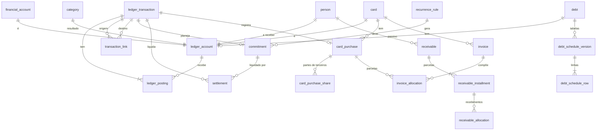

# Modelagem do Banco de Dados — Sistema de Gestão Financeira Pessoal

| Campo | Valor |
|---|---|
| Versão | 0.3 |
| Data | 06/11/2026 |
| Etapa | 4 — Especificação (Fase B) |
| Status | Versão 0.1 aprovada em 06/11/2026 (Fase B); versão 0.2 com detalhes da implementação da Fase 1A (§15) |
| Documentos relacionados | `architecture.md` (§6, §7), `business-rules.md`, `reference-scenarios.md` |

Banco: SQLite em modo WAL, com chaves estrangeiras ligadas (`PRAGMA foreign_keys = ON`) e transações em modo `IMMEDIATE` (ADR-014). Nomes de tabelas e colunas em inglês, como é comum no código; a correspondência com os termos do glossário está na §2.

---

## 1. Convenções

| Convenção | Regra |
|---|---|
| Identificadores | `id` inteiro autoincremental nas tabelas internas; `uuid` (texto) adicional em transações, para referência externa e logs |
| Dinheiro | Colunas `*_cents`, tipo `INTEGER` (64 bits). Nunca `REAL` |
| Taxas | Colunas `*_rate`, tipo `TEXT` com decimal validado (ex.: `"0.020000"`), convertido para `Decimal` no código |
| Datas financeiras | `TEXT` ISO `AAAA-MM-DD` (data sem hora) |
| Carimbos | `TEXT` ISO 8601 em UTC (`AAAA-MM-DDTHH:MM:SSZ`) |
| Enumerações | `TEXT` com `CHECK (col IN (...))` |
| Exclusão | Nenhuma tabela financeira aceita `DELETE`. Entidades cadastrais têm `archived_at` |
| Versão otimista | Coluna `version INTEGER NOT NULL DEFAULT 1` nas entidades editáveis (RN-172) |
| Auditoria | `created_at`, `updated_at` em todas as tabelas; histórico completo em `audit_log` |

## 2. Correspondência com o glossário

| Termo (glossário) | Tabela |
|---|---|
| Conta contábil | `ledger_account` |
| Transação | `ledger_transaction` |
| Perna | `ledger_posting` |
| Vínculo (estorna, corrige) | `transaction_link` |
| Compromisso (conta a pagar, receita prevista, parcela de dívida ou consórcio, aporte planejado) | `commitment` |
| Liquidação | `settlement` |
| Recorrência | `recurrence_rule` |
| Conta financeira | `financial_account` |
| Categoria | `category` |
| Pessoa | `person` |
| Cartão | `card` |
| Compra no cartão / item de abertura | `card_purchase`, `card_purchase_share` |
| Fatura | `invoice` |
| Parcela, encargo, crédito, pagamento alocados à fatura | `invoice_allocation` |
| Valor a receber e suas parcelas | `receivable`, `receivable_installment`, `receivable_allocation` |
| Dívida, consórcio | `debt`, `debt_schedule_version`, `debt_schedule_row` |
| Conciliação de saldo | `balance_reconciliation` |
| Conciliação e eventos de limite | `card_limit_event` |
| Feriado | `holiday` |
| Aparelho confiável | `trusted_device` |

## 3. Diagrama de entidades (núcleo)



## 4. Núcleo do Ledger

### 4.1 `ledger_account` — conta contábil

| Coluna | Tipo | Regra |
|---|---|---|
| id | INTEGER PK | |
| code | TEXT UNIQUE NOT NULL | Ex.: `asset:fin:3`, `expense:cat:12`, `equity:opening` |
| kind | TEXT NOT NULL | `asset`, `liability`, `income`, `expense`, `equity` |
| asset_class | TEXT NULL | `free`, `reserve`, `benefit`, `receivable`; obrigatório se `kind = asset` |
| name | TEXT NOT NULL | |
| owner_type | TEXT NULL | `financial_account`, `card`, `person`, `category`, `debt`, `system` |
| owner_id | INTEGER NULL | |
| is_system | INTEGER NOT NULL DEFAULT 0 | Contas de patrimônio e categorias de sistema |
| archived_at | TEXT NULL | |
| created_at, updated_at | TEXT NOT NULL | |

Restrições:
- `CHECK (kind <> 'asset' OR asset_class IS NOT NULL)`.
- `UNIQUE (owner_type, owner_id)`.

### 4.2 `ledger_transaction` — transação

| Coluna | Tipo | Regra |
|---|---|---|
| id | INTEGER PK | |
| uuid | TEXT UNIQUE NOT NULL | |
| type | TEXT NOT NULL | Código T01 a T28 de `business-rules.md` §4 (ex.: `T08_card_purchase`) |
| status | TEXT NOT NULL | `draft` (interno, nunca persiste após o commit), `forecast` (previsto), `pending` (pendente), `confirmed` (confirmado), `cancelled` (cancelado), `reversed` (estornado) |
| operation_date | TEXT NOT NULL | Data da operação |
| competence_date | TEXT NOT NULL | Data de competência (RN-007) |
| description | TEXT NOT NULL | |
| (notas) | — | Notas acrescentadas ficam na tabela `transaction_note` (§4.9), só por inserção (RN-013) |
| cancel_reason | TEXT NULL | Obrigatório quando `status = cancelled` |
| origin | TEXT NOT NULL DEFAULT 'manual' | `manual`, `system` (recorrência, abertura), `import` |
| external_id | TEXT NULL | Id da instituição, para importação (RF-IMP-02) |
| dedup_hash | TEXT NULL | Hash de data + valor + descrição normalizada + conta |
| review_status | TEXT NULL | `to_review` para importados |
| version | INTEGER NOT NULL DEFAULT 1 | |
| created_device_id | INTEGER NULL FK `trusted_device` | |
| created_at, updated_at | TEXT NOT NULL | |

Índices:
- `(status, operation_date)`;
- `(status, competence_date)`;
- `(dedup_hash)`;
- `UNIQUE (origin, external_id) WHERE external_id IS NOT NULL`.

Restrições:
- `CHECK (status <> 'cancelled' OR cancel_reason IS NOT NULL)`.

### 4.3 `ledger_posting` — perna

| Coluna | Tipo | Regra |
|---|---|---|
| id | INTEGER PK | |
| transaction_id | INTEGER NOT NULL FK | |
| account_id | INTEGER NOT NULL FK `ledger_account` | |
| amount_cents | INTEGER NOT NULL | `CHECK (amount_cents <> 0)`; débito +, crédito − |
| memo | TEXT NULL | Ex.: "principal", "juros", "parte da Ana" |

Índices:
- `(account_id, transaction_id)`;
- `(transaction_id)`.

Pernas de transações previstas e pendentes guardam as pernas **pretendidas**. As consultas de saldo real filtram `status IN ('confirmed', 'reversed')` (RN-011).

### 4.4 `transaction_link` — vínculos

| Coluna | Tipo | Regra |
|---|---|---|
| id | INTEGER PK | |
| kind | TEXT NOT NULL | `reverses` (estorno total), `partially_reverses` (estorno parcial, RN-121), `corrects` (Corrigir), `refunds` (reembolso, T20) |
| from_transaction_id | INTEGER NOT NULL FK | A nova (estorno, correção, reembolso) |
| to_transaction_id | INTEGER NOT NULL FK | A original |
| amount_cents | INTEGER NULL | Para estornos parciais e reembolsos |
| created_at | TEXT NOT NULL | |

Restrições:
- índice único parcial `UNIQUE (to_transaction_id) WHERE kind = 'reverses'` (impede estorno repetido, I-03);
- `CHECK (from_transaction_id <> to_transaction_id)`.

### 4.5 `commitment` — compromisso

Um compromisso é a extensão 1:1 de uma transação prevista ou pendente que gerará pernas de saída ou de entrada (contas, receitas, parcelas de dívida e consórcio, aportes planejados). Parcelas de cartão e de valores a receber **não** são compromissos: são alocações (RN-074, RN-102).

| Coluna | Tipo | Regra |
|---|---|---|
| id | INTEGER PK | |
| transaction_id | INTEGER UNIQUE NOT NULL FK | A transação planejada |
| kind | TEXT NOT NULL | `bill`, `income`, `debt_installment`, `consortium`, `planned_transfer` |
| direction | TEXT NOT NULL | `out`, `in`, `internal` |
| due_date | TEXT NOT NULL | Vencimento original |
| effective_due_date | TEXT NOT NULL | Calculado pelo calendário (RN-072, RN-093), gravado para indexação; recalculado se a tabela de feriados mudar |
| planned_amount_cents | INTEGER NOT NULL | `CHECK (> 0)` |
| value_type | TEXT NOT NULL | `fixed`, `variable` (RN-052) |
| reference_month | TEXT NULL | `AAAA-MM`, competência da despesa (RN-032) |
| expected_account_id | INTEGER NULL FK `financial_account` | |
| payment_method | TEXT NULL | `debit`, `pix`, `boleto`, `cash`, `auto_debit`, `other` |
| scheduled_debit_date | TEXT NULL | Agendado (RN-035) |
| closed_at | TEXT NULL | Encerrado com valor diferente (RN-042) |
| closed_reason | TEXT NULL | |
| recurrence_id | INTEGER NULL FK | |
| installment_group | TEXT NULL | Parcelamento fora do cartão (RN-037) |
| installment_number | INTEGER NULL | |
| debt_id | INTEGER NULL FK | |
| version | INTEGER NOT NULL DEFAULT 1 | |

Índices:
- `(effective_due_date)`;
- `(due_date)`;
- `(recurrence_id, due_date)`.

O valor em aberto (RN-041) é calculado:

```sql
-- valor em aberto de um compromisso (conceitual)
planned_amount_cents
  - COALESCE((SELECT SUM(s.amount_cents)
              FROM settlement s
              JOIN ledger_transaction t ON t.id = s.transaction_id
              WHERE s.commitment_id = c.id AND t.status = 'confirmed'), 0)
```

### 4.6 `settlement` — liquidação

| Coluna | Tipo | Regra |
|---|---|---|
| id | INTEGER PK | |
| commitment_id | INTEGER NOT NULL FK | |
| transaction_id | INTEGER NOT NULL FK | Transação confirmada que liquida |
| amount_cents | INTEGER NOT NULL | `CHECK (> 0)` |
| excess_kind | TEXT NULL | `late_fee` (juros e multa), `higher_actual` (valor real maior); obrigatório se ultrapassar o aberto (RN-043) |

Restrições:
- `UNIQUE (commitment_id, transaction_id)`.

Liquidações cuja transação foi estornada deixam de contar automaticamente (filtro por `status = 'confirmed'`), reabrindo o compromisso (RN-044).

### 4.7 `recurrence_rule` — recorrência

| Coluna | Tipo | Regra |
|---|---|---|
| id | INTEGER PK | |
| name | TEXT NOT NULL | |
| kind | TEXT NOT NULL | Mesmo domínio de `commitment.kind` |
| frequency | TEXT NOT NULL | `weekly`, `monthly`, `yearly`, `every_n_months` |
| interval | INTEGER NOT NULL DEFAULT 1 | |
| day_rule | TEXT NOT NULL | `fixed_day`, `nth_business_day` (salário), `last_day` |
| day_value | INTEGER NULL | Ex.: 10 (dia 10) ou 5 (5º dia útil) |
| amount_cents | INTEGER NOT NULL | |
| value_type | TEXT NOT NULL | `fixed`, `variable` |
| category_id | INTEGER NULL FK | |
| financial_account_id | INTEGER NULL FK | |
| start_date | TEXT NOT NULL | |
| end_date | TEXT NULL | |
| remaining_count | INTEGER NULL | Ex.: 40 parcelas de consórcio |
| active | INTEGER NOT NULL DEFAULT 1 | |
| version | INTEGER NOT NULL DEFAULT 1 | |

### 4.8 `idempotency_record`

| Coluna | Tipo | Regra |
|---|---|---|
| key | TEXT PK | Gerada ao abrir o formulário (RN-170) |
| operation | TEXT NOT NULL | Ex.: `pay_invoice`, `card_purchase` |
| result_type | TEXT NOT NULL | Ex.: `ledger_transaction` |
| result_id | INTEGER NOT NULL | |
| created_at | TEXT NOT NULL | Registros com mais de 30 dias podem ser compactados; nunca antes |

### 4.9 `transaction_note` — notas acrescentadas

| Coluna | Tipo | Regra |
|---|---|---|
| id | INTEGER PK | |
| transaction_id | INTEGER NOT NULL FK | |
| text | TEXT NOT NULL | |
| created_at | TEXT NOT NULL | |

Só inserção (gatilho `note_append_only`).

## 5. Cadastros

### 5.1 `financial_account`

| Coluna | Tipo | Regra |
|---|---|---|
| id | INTEGER PK | |
| name | TEXT NOT NULL | |
| account_type | TEXT NOT NULL | `checking`, `digital`, `cash`, `reserve`, `benefit`, `other` |
| asset_class | TEXT NOT NULL | `free`, `reserve`, `benefit` |
| institution | TEXT NULL | |
| ledger_account_id | INTEGER UNIQUE NOT NULL FK | |
| opening_date | TEXT NOT NULL | |
| archived_at | TEXT NULL | |
| version | INTEGER NOT NULL DEFAULT 1 | |

### 5.2 `category`

| Coluna | Tipo | Regra |
|---|---|---|
| id | INTEGER PK | |
| name | TEXT NOT NULL | |
| kind | TEXT NOT NULL | `income`, `expense` |
| parent_id | INTEGER NULL FK `category` | Um nível de subcategoria |
| is_system | INTEGER NOT NULL DEFAULT 0 | RF-CAT-03 |
| accepts_benefit | INTEGER NOT NULL DEFAULT 0 | RN-186 |
| icon, color | TEXT NULL | Ver `ui-ux-specification.md` |
| sort_order | INTEGER NOT NULL DEFAULT 0 | |
| ledger_account_id | INTEGER UNIQUE NOT NULL FK | |
| archived_at | TEXT NULL | |

### 5.3 `person`

| Coluna | Tipo | Regra |
|---|---|---|
| id | INTEGER PK | |
| name | TEXT NOT NULL UNIQUE | |
| notes | TEXT NULL | |
| ledger_account_id | INTEGER UNIQUE NOT NULL FK | Conta "A receber" da pessoa |
| archived_at | TEXT NULL | |

## 6. Cartões

### 6.1 `card`

| Coluna | Tipo | Regra |
|---|---|---|
| id | INTEGER PK | |
| name, issuer, brand | TEXT | |
| credit_limit_cents | INTEGER NOT NULL | Limite total atual; histórico em `card_limit_event` |
| closing_day | INTEGER NOT NULL | `CHECK (BETWEEN 1 AND 31)` |
| due_day | INTEGER NOT NULL | `CHECK (BETWEEN 1 AND 31 AND due_day <> closing_day)` |
| closing_day_goes_next | INTEGER NOT NULL DEFAULT 1 | Compra no dia do fechamento vai para a próxima fatura (RN-070) |
| remainder_on | TEXT NOT NULL DEFAULT 'first' | `first`, `last` (RN-005) |
| consumes_full_limit | INTEGER NOT NULL DEFAULT 1 | RN-086 |
| default_payment_account_id | INTEGER NULL FK `financial_account` | |
| ledger_account_id | INTEGER UNIQUE NOT NULL FK | |
| archived_at | TEXT NULL | |
| version | INTEGER NOT NULL DEFAULT 1 | |

### 6.2 `card_purchase` — compra e item de abertura

| Coluna | Tipo | Regra |
|---|---|---|
| id | INTEGER PK | |
| transaction_id | INTEGER UNIQUE NOT NULL FK | Transação T08, T09, T10, T24 ou T25 |
| card_id | INTEGER NOT NULL FK | |
| purchase_date | TEXT NOT NULL | Para itens de abertura: data original |
| description | TEXT NOT NULL | |
| total_cents | INTEGER NOT NULL | Total original da compra |
| installments_count | INTEGER NOT NULL DEFAULT 1 | `CHECK (BETWEEN 1 AND 48)` |
| installment_cents | INTEGER NOT NULL | Valor-base da parcela (RN-005) |
| first_installment_cents | INTEGER NOT NULL | Parcela que recebe o resto |
| is_opening_item | INTEGER NOT NULL DEFAULT 0 | |
| opening_kind | TEXT NULL | `closed_invoice`, `open_invoice`, `remaining_installments` |
| installments_already_billed | INTEGER NOT NULL DEFAULT 0 | Só itens de abertura |
| opening_amount_cents | INTEGER NULL | Valor registrado na abertura (ex.: 1.200,00 das parcelas restantes) |
| first_invoice_due_date | TEXT NULL | Preenchido pela alocação (MVP-3) ou informado na abertura |

Restrições:
- `CHECK (first_installment_cents + installment_cents * (installments_count - 1) = total_cents)` (I-06).

### 6.3 `card_purchase_share` — partes de terceiros

| Coluna | Tipo | Regra |
|---|---|---|
| id | INTEGER PK | |
| card_purchase_id | INTEGER NOT NULL FK | |
| person_id | INTEGER NOT NULL FK | |
| amount_cents | INTEGER NOT NULL | `CHECK (> 0)` |
| receivable_id | INTEGER NULL FK | Gerado na compra (MVP-1: sem parcelas; MVP-4: com parcelas) |

Parte própria = `total_cents − Σ amount_cents`. Ela deve ser ≥ 0 (validação de serviço e invariante).

### 6.4 `invoice` — fatura (MVP-3)

| Coluna | Tipo | Regra |
|---|---|---|
| id | INTEGER PK | |
| card_id | INTEGER NOT NULL FK | |
| original_due_date | TEXT NOT NULL | Identifica a fatura (RN-070) |
| effective_due_date | TEXT NOT NULL | |
| closing_date | TEXT NOT NULL | |
| period_start, period_end | TEXT NOT NULL | |
| informed_total_cents | INTEGER NULL | Conciliação (RN-081) |
| reconciled_at | TEXT NULL | |

Restrições:
- `UNIQUE (card_id, original_due_date)`.

O estado (aberta, fechada, paga parcialmente, paga, vencida) é calculado (RN-076).

### 6.5 `invoice_allocation`

| Coluna | Tipo | Regra |
|---|---|---|
| id | INTEGER PK | |
| invoice_id | INTEGER NOT NULL FK | |
| kind | TEXT NOT NULL | `installment`, `charge` (encargo), `credit` (estorno ou excedente), `carryover_in`, `carryover_out`, `payment` |
| amount_cents | INTEGER NOT NULL | Positivo aumenta a fatura; negativo reduz (pagamentos, créditos, `carryover_out`) |
| card_purchase_id | INTEGER NULL FK | Para `installment` |
| installment_number | INTEGER NULL | |
| transaction_id | INTEGER NULL FK | Transação de origem (encargo, pagamento, estorno) |
| cancelled_by_transaction_id | INTEGER NULL FK | Parcela cancelada por estorno (RN-084) |

Restrições:
- `UNIQUE (card_purchase_id, installment_number) WHERE kind = 'installment'`.

Valor em aberto da fatura = Σ `amount_cents` das alocações não canceladas.

### 6.6 `card_limit_event`

| Coluna | Tipo | Regra |
|---|---|---|
| id | INTEGER PK | |
| card_id | INTEGER NOT NULL FK | |
| event_date | TEXT NOT NULL | |
| kind | TEXT NOT NULL | `limit_change`, `reconciliation` |
| new_limit_cents | INTEGER NULL | Para `limit_change` |
| informed_available_cents | INTEGER NULL | |
| calculated_available_cents | INTEGER NULL | |
| difference_cents | INTEGER NULL | |
| probable_cause | TEXT NULL | `payment_clearing`, `missing_purchase`, `missing_charge`, `limit_change`, `issuer_rule`, `unknown` |
| notes | TEXT NULL | |

## 7. Valores a receber

### 7.1 `receivable`

| Coluna | Tipo | Regra |
|---|---|---|
| id | INTEGER PK | |
| person_id | INTEGER NOT NULL FK | |
| origin_kind | TEXT NOT NULL | `loan`, `card_share`, `opening` |
| origin_transaction_id | INTEGER NOT NULL FK | T14, T09, T10 ou T25 |
| total_cents | INTEGER NOT NULL | |
| description | TEXT NOT NULL | |

### 7.2 `receivable_installment`

| Coluna | Tipo | Regra |
|---|---|---|
| id | INTEGER PK | |
| receivable_id | INTEGER NOT NULL FK | |
| number | INTEGER NOT NULL | |
| due_date | TEXT NOT NULL | Editável (RN-101), com auditoria |
| amount_cents | INTEGER NOT NULL | |

Restrições:
- `UNIQUE (receivable_id, number)`.

No MVP-1, cada valor a receber tem uma única parcela com vencimento informado (ou o da fatura).

### 7.3 `receivable_allocation`

| Coluna | Tipo | Regra |
|---|---|---|
| id | INTEGER PK | |
| installment_id | INTEGER NOT NULL FK | |
| transaction_id | INTEGER NOT NULL FK | Recebimento (T15), baixa (T16) ou estorno de compra (RN-085) |
| kind | TEXT NOT NULL | `receipt`, `write_off`, `purchase_reversal` |
| amount_cents | INTEGER NOT NULL | `CHECK (> 0)` |

O estado da parcela (pendente, recebida parcialmente, recebida, atrasada, baixada) é calculado.

## 8. Dívidas e consórcio

### 8.1 `debt`

| Coluna | Tipo | Regra |
|---|---|---|
| id | INTEGER PK | |
| kind | TEXT NOT NULL | `loan`, `consortium` |
| creditor, description | TEXT NOT NULL | |
| original_amount_cents | INTEGER NULL | |
| monthly_rate | TEXT NULL | Decimal; obrigatório para `loan` |
| amortization_system | TEXT NULL | `price` (MVP); `sac` (pós-MVP) |
| contract_installment_cents | INTEGER NULL | Parcela do contrato (RN-110) |
| due_day | INTEGER NOT NULL | |
| extra_payment_default | TEXT NOT NULL DEFAULT 'reduce_term' | ADR-027 |
| ledger_account_id | INTEGER NULL FK | Passivo; `NULL` para consórcio (ADR-008) |
| recurrence_id | INTEGER NULL FK | Consórcio |
| archived_at | TEXT NULL | |
| version | INTEGER NOT NULL DEFAULT 1 | |

### 8.2 `debt_schedule_version` e `debt_schedule_row`

Cada recálculo (abertura, amortização extra, divergência com o extrato) cria uma nova versão da tabela. As anteriores ficam no histórico.

| `debt_schedule_version` | Tipo |
|---|---|
| id | INTEGER PK |
| debt_id | INTEGER FK |
| created_at | TEXT |
| reason | TEXT (`opening`, `extra_payment`, `statement_divergence`, `simulation`) |
| is_current | INTEGER (um único `1` por dívida; índice único parcial) |
| balance_cents, monthly_rate, remaining_installments, installment_cents | |

| `debt_schedule_row` | Tipo |
|---|---|
| version_id | INTEGER FK |
| number | INTEGER |
| due_date | TEXT |
| payment_cents, interest_cents, principal_cents, balance_after_cents | INTEGER |

Simulações (RN-114) são calculadas em memória e não gravam versão, salvo se o usuário pedir para guardar (`reason = 'simulation'`, `is_current = 0`).

## 9. Conciliação, calendário e configurações

### 9.1 `balance_reconciliation`

| Coluna | Tipo |
|---|---|
| id | INTEGER PK |
| financial_account_id | INTEGER FK |
| reconciliation_date | TEXT |
| informed_cents, calculated_cents, difference_cents | INTEGER |
| adjustment_transaction_id | INTEGER NULL FK (T27) |
| status | TEXT (`reconciled`, `to_reconcile`) (RN-133) |
| notes | TEXT |

### 9.2 `holiday`

| Coluna | Tipo | Regra |
|---|---|---|
| date | TEXT PK | |
| name | TEXT NOT NULL | |
| scope | TEXT NOT NULL | `national`, `state`, `municipal`, `carnival`, `custom` |
| affects_salary | INTEGER NOT NULL DEFAULT 1 | |
| affects_banking | INTEGER NOT NULL DEFAULT 1 | |

### 9.3 `setting`

| Coluna | Tipo | Exemplos |
|---|---|---|
| key | TEXT PK | `horizon_mode` (`next_salary`, `month_end`), `safety_minimum_cents`, `alert_days_before`, `theme`, `backup_time`, `retention` |
| value | TEXT (JSON) | |
| version | INTEGER | |

## 10. Segurança, operação e auditoria

| Tabela | Conteúdo principal |
|---|---|
| `auth_user`, `django_session` | Padrão do Django; um único usuário; sessões no banco |
| `axes_*` | Tentativas e bloqueios de login (django-axes) |
| `trusted_device` | id, nome, `token_hash`, `pin_hash`, `created_at`, `expires_at`, `last_used_at`, `failed_pin_attempts`, `revoked_at`, `user_agent_summary` |
| `audit_log` | id, `at`, `device_id`, `action`, `entity_type`, `entity_id`, `before_json`, `after_json`, `reason` |
| `job_run` | id, `job_name`, `scheduled_for`, `started_at`, `finished_at`, `status`, `message`; `UNIQUE (job_name, scheduled_for)` garante idempotência das tarefas |
| `backup_record` | id, `created_at`, `trigger` (`daily`, `pre_update`, `pre_migration`, `manual`), `file_name`, `sha256`, `size_bytes`, `schema_version`, `app_version`, `checks_passed`, `local_ok`, `cloud_ok`, `retention_class`, `pruned_at` |
| `restore_test` | id, `at`, `backup_id`, `kind` (`auto`, `manual`), `passed`, `details_json` |
| `notification` | id, `created_at`, `kind`, `channel` (`dashboard`, `telegram`), `summary`, `sent_at`, `status`, `dedup_key` UNIQUE (evita alerta repetido) |

Segredos (token do Telegram, senha de backup, chave da aplicação) **não** ficam no banco (ADR-020).

## 11. Gatilhos de integridade

Segunda barreira, além dos serviços (`architecture.md` §6.4).

| Gatilho | Regra |
|---|---|
| `posting_no_update` | `BEFORE UPDATE ON ledger_posting` → erro. Pernas nunca mudam. |
| `posting_no_delete` | `BEFORE DELETE ON ledger_posting` → erro. |
| `posting_insert_only_draft_or_planned` | `BEFORE INSERT ON ledger_posting` → erro se a transação não estiver em `draft`, `forecast` ou `pending`. |
| `txn_no_delete` | `BEFORE DELETE ON ledger_transaction` → erro. |
| `txn_insert_draft_only` | `BEFORE INSERT ON ledger_transaction` → erro se `status <> 'draft'`. Toda transação nasce em rascunho, e o gatilho de finalização confere o equilíbrio. Assim nenhuma transação confirmada existe sem pernas. |
| `link_immutable` | `BEFORE UPDATE OR DELETE ON transaction_link` → erro. |
| `note_append_only` | `BEFORE UPDATE OR DELETE ON transaction_note` → erro. |
| `txn_immutable_confirmed` | `BEFORE UPDATE ON ledger_transaction` quando `OLD.status IN ('confirmed','reversed','cancelled')`: erro se mudar `type`, `operation_date`, `competence_date` ou `description`. Única troca de estado permitida: `confirmed → reversed`. |
| `txn_valid_transition` | `BEFORE UPDATE OF status`: só as transições de `business-rules.md` §3.2, mais `draft →` estado final. |
| `txn_balanced_on_finalize` | `BEFORE UPDATE OF status` saindo de `draft`: erro se `SUM(amount_cents) <> 0` ou se houver menos de 2 pernas (I-01, I-02). |
| `reversal_requires_link` | `BEFORE UPDATE` para `reversed`: exige `transaction_link` `reverses` apontando para a transação. |
| `audit_append_only` | `BEFORE UPDATE OR DELETE ON audit_log` → erro. |
| `settlement_requires_confirmed` | `BEFORE INSERT ON settlement`: a transação precisa estar confirmada. |

Fluxo de gravação de uma transação (dentro de `BEGIN IMMEDIATE`):
1. Inserir a transação com `status = 'draft'`.
2. Inserir as pernas.
3. Atualizar para o estado final; o gatilho confere o equilíbrio.
4. Commit.

Nenhuma transação `draft` sobrevive ao commit; o teste de invariantes verifica isso.

## 12. Consultas de saldo (conceito)

```sql
-- Saldo de uma conta contábil até uma data (RN-003, RN-141)
SELECT COALESCE(SUM(p.amount_cents), 0)
FROM ledger_posting p
JOIN ledger_transaction t ON t.id = p.transaction_id
WHERE p.account_id = :account
  AND t.status IN ('confirmed', 'reversed')
  AND t.operation_date <= :date;

-- Saldo bancário (contas livres e reserva)
SELECT COALESCE(SUM(p.amount_cents), 0)
FROM ledger_posting p
JOIN ledger_transaction t ON t.id = p.transaction_id
JOIN ledger_account a ON a.id = p.account_id
WHERE a.kind = 'asset' AND a.asset_class IN ('free', 'reserve')
  AND t.status IN ('confirmed', 'reversed')
  AND t.operation_date <= :today;
```

Saldo comprometido, disponível e projetado são compostos no módulo `balances` a partir de:
- saldos das contas;
- valor em aberto de compromissos (§4.5);
- valor em aberto de faturas (§6.5) ou a estimativa pré-MVP-3 (RN-075);
- parcelas a receber em aberto (§7).

As fórmulas são as de `business-rules.md` §14.

Volume esperado: ~3.000 transações e ~8.000 pernas por ano. Com os índices acima, as consultas ficam bem abaixo de 100 ms no SQLite. Cache de saldo não é necessário no MVP; se surgir, será derivado e conferido pela invariante I-04.

## 13. Evolução do esquema por entrega

| Entrega | Tabelas criadas ou alteradas |
|---|---|
| MVP-1 | Núcleo completo (§4, exceto uso pleno de `commitment` e `recurrence_rule`); cadastros (§5); `card`, `card_purchase`, `card_purchase_share`, `card_limit_event`; `receivable` e `receivable_installment` (uma parcela); `debt` e passivo; `balance_reconciliation`; `holiday`; `setting`; segurança, operação e auditoria (§10); gatilhos (§11) |
| MVP-2 | Uso pleno de `commitment`, `settlement`, `recurrence_rule`; `notification` |
| MVP-3 | `invoice`, `invoice_allocation`; migração que gera faturas e parcelas a partir de `card_purchase` (inclusive itens de abertura), sem tocar em pernas |
| MVP-4 | Parcelas múltiplas em `receivable_installment`, `receivable_allocation`; migração que cria as parcelas das partes de terceiros do MVP-1 |
| MVP-5 | `debt_schedule_version`, `debt_schedule_row`; compromissos `debt_installment` gerados pela tabela |
| Pós-MVP | Metas (`goal`, marca de meta em transferências), orçamento (`budget`), importação (lotes e linhas importadas), relatórios salvos |

Toda migração:
1. roda após backup automático (RF-BKP-01);
2. é testada com uma cópia do banco real antes de ser aplicada;
3. termina com a verificação das invariantes.

## 14. Rastreabilidade com as regras de negócio

| Regras | Estruturas |
|---|---|
| RN-001 a RN-007 | Convenções §1; `ledger_posting.amount_cents`; `ledger_transaction.operation_date`, `competence_date` |
| RN-010 a RN-014, §3.2 | `ledger_transaction.status`; gatilhos `txn_valid_transition`, `txn_immutable_confirmed`, `txn_no_delete` |
| RN-040 a RN-044 | `commitment`, `settlement` |
| RN-050 a RN-055 | `recurrence_rule`, `commitment.recurrence_id` |
| RN-060 a RN-064 | `ledger_account.asset_class`, `commitment.kind = 'planned_transfer'` |
| RN-070 a RN-089 | `card`, `card_purchase`, `card_purchase_share`, `invoice`, `invoice_allocation`, `card_limit_event` |
| RN-100 a RN-107 | `receivable`, `receivable_installment`, `receivable_allocation` |
| RN-110 a RN-118 | `debt`, `debt_schedule_version`, `debt_schedule_row`, `commitment.debt_id` |
| RN-120 a RN-125 | `transaction_link`, índice único parcial de `reverses` |
| RN-130 a RN-133 | `balance_reconciliation`, conta `equity:adjustments` |
| RN-140 a RN-153 | Consultas §12; `setting.horizon_mode`, `safety_minimum_cents` |
| RN-160 a RN-167 | `competence_date`, `card_purchase` (visão por parcela) |
| RN-090 a RN-094 | `holiday`, `commitment.effective_due_date` |
| RN-170 a RN-173 | `idempotency_record`, colunas `version` |
| RN-180 a RN-186 | `CHECK` e validações de serviço |
| RN-190 a RN-192 | `audit_log`, gatilho `audit_append_only` |
| I-01 a I-10 | Gatilhos §11 e verificação de invariantes (`architecture.md` §6.6) |

## 15. Alterações após a aprovação

| Versão | Alteração | Motivo |
|---|---|---|
| 0.2 | Notas acrescentadas saem da coluna `ledger_transaction.notes` para a tabela `transaction_note` (§4.9) | Só inserção é mais simples de garantir com gatilho do que "só acréscimo" numa coluna de texto |
| 0.2 | Novos gatilhos `txn_insert_draft_only`, `link_immutable` e `note_append_only` (§11) | Fecham caminhos que contornariam o equilíbrio e a imutabilidade |
| 0.2 | Testes que gravam de verdade no banco (concorrência) removem e recriam os gatilhos de exclusão só para limpar o banco de teste (`tests/conftest.py`) | O `flush` do Django usa `DELETE`, que os gatilhos bloqueiam. Em produção os gatilhos nunca são removidos |
| 0.3 | `backup_record`: sem `retention_class` e `pruned_at` (a retenção é decidida pelos manifestos nas pastas, não pelo banco, que volta no tempo numa restauração); com `message`; gatilho `pre_restore` | Fase 1D: o banco restaurado não sabe quais arquivos existem hoje nas pastas |
| 0.3 | `restore_test`: `file_name` no lugar de `backup_id`; tipo `restore` para restaurações reais | Fase 1D: o backup testado pode ter sido gerado por outro banco (nuvem, outro PC) |
