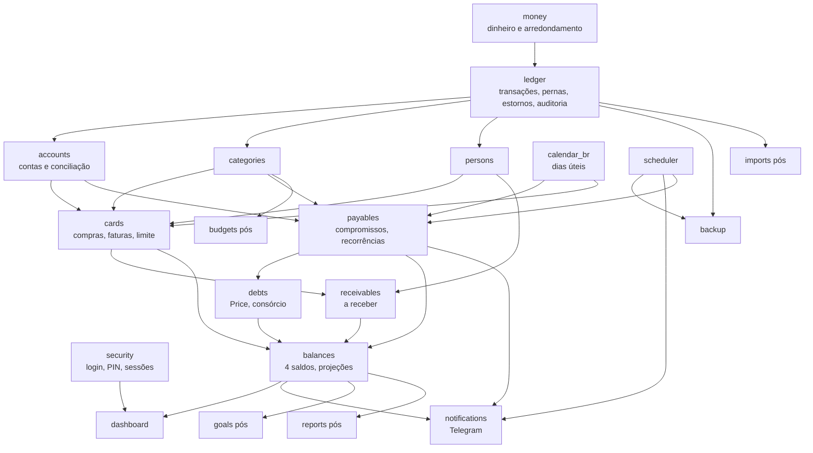

# Roadmap de Implementação — Sistema de Gestão Financeira Pessoal

| Campo | Valor |
|---|---|
| Versão | 0.1 |
| Data | 06/11/2026 |
| Etapa | 6 — Planejamento (Fase B) |
| Status | Aprovado pelo usuário em 06/11/2026 (Fase B) |
| Documentos relacionados | Todos os documentos de `docs/` |

A implementação só começa depois de o usuário escrever `AUTORIZO O DESENVOLVIMENTO`. Cada fase termina com seus critérios de aceitação. Cada entrega MVP termina com a porta de validação de `testing-plan.md` §13 e a aprovação do usuário. Nenhuma fase começa antes da anterior ser aceita.

---

## 1. Visão geral


Tamanho relativo de cada fase: P (pequena), M (média), G (grande). Serve só para comparação entre fases, não é prazo.

| Fase | Tamanho | Entrega usável pelo usuário? |
|---|---|---|
| 0 | P | Não |
| 1A | G | Não (sem interface) |
| 1B | G | Parcialmente (lançar e ver saldos) |
| 1C | M | Sim (uso diário começa ao fim do MVP-1) |
| 1D | M | Sim, com backup e serviço |
| 2A | M | Não isoladamente |
| 2B | M | Sim |
| 3A | M | Não isoladamente |
| 3B | M | Sim |
| 4 | P | Sim |
| 5 | M | Sim |
| 6 | M | Sim |

## 2. Mapa de dependências entre módulos



Regras do mapa:
- Setas indicam "depende de".
- Só o `ledger` grava pernas (`architecture.md` §5).
- Módulos de leitura (`balances`, `dashboard`, `reports`) nunca escrevem.
- `cards` depende de `calendar_br` só a partir do MVP-3 (vencimento efetivo). No MVP-1 usa apenas o vencimento original.

## 3. Estrutura de arquivos prevista

```
Programa Financeiro/
├── docs/                         # esta documentação
├── pyproject.toml                # dependências (uv)
├── uv.lock                       # versões travadas
├── manage.py
├── README.md                     # guia rápido
├── config/
│   ├── settings/ (base.py, prod.py, test.py)
│   ├── urls.py
│   └── wsgi.py
├── apps/
│   ├── money/                    # Money, arredondamento, rateio, formatação
│   ├── calendar_br/              # feriados, dias úteis
│   ├── ledger/                   # models, services, triggers, invariants
│   ├── security/                 # login, PIN, aparelhos, sessões
│   ├── accounts/  categories/  persons/
│   ├── entries/                  # lançamentos do usuário, movimentações, Corrigir/Estornar
│   ├── ui/                       # layout, temas, PWA, cabeçalhos de segurança
│   ├── cards/                    # compras, faturas, alocação, limite
│   ├── receivables/
│   ├── payables/                 # compromissos, liquidação, recorrências
│   ├── debts/                    # Price, consórcio, simulação
│   ├── balances/                 # saldos, comprometido, projeções
│   ├── dashboard/
│   ├── notifications/            # dashboard + Telegram
│   ├── scheduler/                # tarefas e recuperação
│   ├── backup/                   # backup, verificação, restauração
│   └── ui/                       # componentes de template compartilhados
├── templates/
├── static/                       # CSS gerado, htmx, Alpine, ECharts, Inter, Lucide (todos locais)
├── tailwind/                     # entrada do Tailwind e tokens de cor
├── ops/
│   ├── service/                  # configuração do WinSW
│   ├── install.ps1  update.ps1  restore.ps1  reset-password.ps1
│   └── guides/                   # guias passo a passo (Tailscale, Telegram, recuperação)
└── tests/                        # ver testing-plan.md §3
```

## 4. Fases

### Fase 0 — Fundação técnica

| Item | Conteúdo |
|---|---|
| Objetivo | Projeto criado, ferramentas funcionando, padrões de código definidos |
| Funcionalidades | Nenhuma visível ao usuário |
| Tarefas | Criar repositório Git; `pyproject.toml` com Django LTS, Waitress, argon2-cffi, django-axes, keyring, pytest, Hypothesis, time-machine, Playwright, Ruff, coverage, pip-audit; configurações separadas (base, prod, test); SQLite com WAL, chaves estrangeiras e modo `IMMEDIATE`; Ruff com regra que proíbe `float` em `apps/money`, `ledger`, `cards`, `debts`, `balances`; esqueleto de `tests/`; localização pt-BR e fuso America/Sao_Paulo |
| Arquivos | `pyproject.toml`, `uv.lock`, `manage.py`, `config/`, `tests/conftest.py`, `.gitignore` (exclui banco, backups, logs, `.env`) |
| Dependências | Aprovação do projeto (`AUTORIZO O DESENVOLVIMENTO`) |
| Critérios de aceitação | `uv run pytest` roda (zero testes falhando); `uv run ruff check` limpo; servidor sobe em `127.0.0.1` |
| Testes | Teste de fumaça de configuração (fuso, idioma, `foreign_keys = ON`, modo WAL) |
| Resultado esperado | Base pronta para o núcleo |

### Fase 1A — Núcleo do Ledger (sem interface)

| Item | Conteúdo |
|---|---|
| Objetivo | Ledger correto, imutável, atômico e verificável, testado antes de qualquer tela |
| Funcionalidades | RF-LED-01 a 11; RN-001 a RN-014, RN-120 a RN-125, RN-170 a RN-173, RN-190 a RN-192 |
| Tarefas | Tipo `Money` e rateio (RN-005); modelos `ledger_account`, `ledger_transaction`, `ledger_posting`, `transaction_link`, `idempotency_record`, `audit_log`; serviço do Ledger: registrar transação, cancelar, estornar total e parcial, corrigir, acrescentar nota; fluxo `draft` → final; gatilhos (`database-design.md` §11); verificador de invariantes I-01 a I-04, I-08, I-09; plano de contas de sistema (patrimônio e categorias de sistema) |
| Arquivos | `apps/money/*`, `apps/ledger/{models,services,invariants,audit}.py`, migração com gatilhos, `tests/unit/test_money*.py`, `tests/integration/ledger/*`, `tests/property/test_ledger_properties.py` |
| Dependências | Fase 0 |
| Critérios de aceitação | Toda transação soma zero; gatilhos recusam alterações proibidas; correção e estorno funcionam; duplo envio não duplica |
| Testes | Unidade de `Money` e rateio (S01); gatilhos (§7.3); atomicidade (§7.2); idempotência (§7.4); propriedades com 1.000 exemplos; S11 e S12 no nível de serviço |
| Resultado esperado | Núcleo confiável, com cobertura ≥ 95% |

### Fase 1B — Cadastros, lançamentos e segurança

| Item | Conteúdo |
|---|---|
| Objetivo | Usuário entra com segurança, cadastra contas e lança gastos e recebimentos pelo celular |
| Funcionalidades | RF-CON-01, 03, 04, 06; RF-CAT-01 a 03; RF-LAN-01, 03, 04, 06; RF-SEG-01 a 06; RF-CFG-04; F-001 (parte de segurança), F-010, F-011 (tipos básicos), F-013, F-014, F-020, F-021 |
| Tarefas | Layout base (barra lateral e inferior), tokens de cor, tipografia, temas, PWA (manifesto e service worker mínimo); componentes da `ui-ux-specification.md` §9; login com Argon2id, django-axes, sessões, aparelho confiável e PIN; contas financeiras com classes; categorias padrão (`functional-specification.md` §14); lançamento rápido e completo; transferências; lista de movimentações com filtros; Corrigir e Estornar; detalhe com auditoria; saldo por conta |
| Arquivos | `apps/security/*`, `apps/accounts/*`, `apps/categories/*`, `apps/ui/*`, `templates/{base,components,accounts,ledger}/*`, `static/*`, `tailwind/*`, `tests/security/*`, `tests/e2e/test_lancamento_rapido.py` |
| Dependências | 1A |
| Critérios de aceitação | Lançamento rápido em 4 toques no celular; "Desfazer" funciona; nenhuma rota acessível sem login; PIN e bloqueio conforme `security-plan.md` §3 |
| Testes | S08; segurança §9 (exceto rede); E2E: lançamento rápido, duplo toque, Corrigir |
| Resultado esperado | Sistema usável localmente para lançamentos básicos |

### Fase 1C — Cartões, a receber e dívida provisórios; abertura; conciliação

| Item | Conteúdo |
|---|---|
| Objetivo | Registrar tudo o que existe em 01/11/2026 e o uso diário com cartões e terceiros |
| Funcionalidades | RF-CAR-01, 02, 02a, 03, 12 (básico); RF-REC-01, 02, 04 (simples); RF-DIV-00; RF-CON-02, 05; RF-DSH-01; RF-LED-12 (saldos); RF-IMP-02; F-002, F-012, F-022, F-040, F-041, F-050 a F-052 (simples), F-060, F-070 (bloco de saldos), F-071 (saldos) |
| Tarefas | Cartões (contas de passivo); `card_purchase` e `card_purchase_share`; itens de abertura; estimativa do devido até H (RN-075); pessoas e valores a receber com uma parcela; empréstimo a terceiro e recebimento simples; dívida como passivo e pagamento manual com principal e juros; assistente de abertura (atômico); conciliação de saldo com marcos; dashboard com saldo bancário, guardado e benefícios; "de onde vem" dos saldos |
| Arquivos | `apps/cards/*`, `apps/persons/*`, `apps/receivables/*` (básico), `apps/debts/*` (básico), `apps/accounts/reconciliation.py`, `apps/dashboard/*` (básico), templates correspondentes |
| Dependências | 1B |
| Critérios de aceitação | Abertura S00 reproduzida pela interface com os totais esperados; compra de terceiro nunca entra em despesas; conciliação gera ajuste rastreável |
| Testes | S00, S03 (sem parcelas), S10-B, S13 (saldo); E2E: assistente de abertura, dividir com alguém, conciliação |
| Resultado esperado | Usuário consegue registrar sua situação real e lançar o dia a dia |

### Fase 1D — Operação: serviço, agendador e backup

| Item | Conteúdo |
|---|---|
| Objetivo | Sistema rodando sozinho no PC, acessível pelo celular com HTTPS, com dados protegidos e recuperáveis |
| Funcionalidades | RF-BKP-01 a 06; RF-SEG-06; F-001 completo, F-100; tela de saúde |
| Tarefas | Waitress e configuração do WinSW (com verificação da conta do Windows e plano B no Agendador de Tarefas); agendador interno com `job_run` e recuperação de atrasadas; segredos no cofre do Windows (`keyring`); backup (cópia online, verificações, manifesto, `age`, local + nuvem, retenção); restauração guiada e modo teste; teste mensal automático; tela de saúde; `install.ps1`, `update.ps1`, `restore.ps1`, `reset-password.ps1`; guias do Tailscale Serve, da criptografia do disco e de recuperação de desastre |
| Arquivos | `apps/scheduler/*`, `apps/backup/*`, `ops/service/*`, `ops/*.ps1`, `ops/guides/*`, `tests/backup/*` |
| Dependências | 1C |
| Critérios de aceitação | Checklist de instalação (`security-plan.md` §12) completo no PC do usuário; celular acessa pelo endereço `ts.net` com cadeado; reinício do PC volta o serviço sozinho; backup na nuvem visível; restauração em modo teste OK |
| Testes | Backup §10 completo; teste de configuração de escuta; recuperação de tarefa atrasada |
| Resultado esperado | **Porta MVP-1** (`testing-plan.md` §13): duas semanas de uso real com conciliação sem diferenças não explicadas |

### Fase 2A — Compromissos, liquidação, recorrências e calendário

| Item | Conteúdo |
|---|---|
| Objetivo | Representar o futuro (contas, receitas, parcelas) sem afetar o saldo real |
| Funcionalidades | RF-PAG-01 a 06, 09; RF-LAN-02 (previstas), 05; RF-CFG-03; RN-020 a RN-055, RN-090 a RN-094 |
| Tarefas | `calendar_br` com tabela de feriados pré-carregada (RN-092) e Carnaval pela Páscoa; `commitment`, `settlement`, `recurrence_rule`; janela móvel de 13 meses; previsto → pendente para fixos em H; pagar, pagamento parcial, juros e multa, encerrar com valor diferente, agendar, cancelar; reembolso; salário no 5º dia útil; consórcio como recorrência fixa |
| Arquivos | `apps/calendar_br/*`, `apps/payables/*`, `tests/unit/test_calendar.py`, `tests/integration/payables/*` |
| Dependências | Porta MVP-1 |
| Critérios de aceitação | Tabela de 5º dia útil de 2026 e 2027 exata (`testing-plan.md` §8); nenhum previsto ou pendente afeta saldo real; mudança de recorrência só altera o futuro |
| Testes | Calendário; combinações de §6 relativas a compromissos; propriedades com compromissos |
| Resultado esperado | Futuro modelado |

### Fase 2B — Central de pagamentos, saldo disponível e alertas

| Item | Conteúdo |
|---|---|
| Objetivo | Usuário vê o que vence, quanto pode gastar e recebe avisos no Telegram |
| Funcionalidades | RF-PAG-07, 08; RF-DSH-02, 05 (vencimentos); RF-ALE-01 a 03; RF-SEG-07; RF-CFG-01, 02; F-030 a F-036, F-080 (vencimentos, atraso, segurança, backup) |
| Tarefas | Telas de pagamentos, calendário, recorrências, configurações de saldos e alertas; `balances` com saldo comprometido (H) e disponível (com cartão estimado); bloco de atenção e próximos vencimentos; `notifications` com Telegram (token no cofre, `chat_id` único, deduplicação, silêncio noturno) |
| Arquivos | `apps/balances/*`, `apps/notifications/*`, `templates/payables/*`, `templates/dashboard/*` |
| Dependências | 2A |
| Critérios de aceitação | Disponível igual ao calculado à mão em 3 datas; alertas chegam no horário, sem duplicar |
| Testes | S14 parcial; alertas com relógio simulado; E2E: pagar parcial e depois o resto |
| Resultado esperado | **Porta MVP-2**: um ciclo de salário completo sem alerta errado ou faltando |

### Fase 3A — Faturas e migração

| Item | Conteúdo |
|---|---|
| Objetivo | Faturas reais calculadas a partir das compras, sem tocar no Ledger |
| Funcionalidades | RF-CAR-04, 05; RN-070 a RN-077 |
| Tarefas | `invoice`, `invoice_allocation`; algoritmo de ciclo e alocação; vencimento efetivo; migração a partir de `card_purchase` e itens de abertura; associação dos pagamentos do MVP-1; relatório de conferência por fatura; substituir a estimativa RN-075 pelo valor real; I-06 e I-07 no verificador |
| Arquivos | `apps/cards/{allocation,invoices,migration}.py`, migração de dados, `tests/integration/cards/*` |
| Dependências | Porta MVP-2 |
| Critérios de aceitação | Hash das pernas igual antes e depois da migração; faturas de S00 + S14 iguais às esperadas |
| Testes | S02; migração §11; propriedades com I-07 |
| Resultado esperado | Faturas disponíveis |

### Fase 3B — Operações de fatura e limite

| Item | Conteúdo |
|---|---|
| Objetivo | Pagar, conciliar e corrigir faturas como no app do banco |
| Funcionalidades | RF-CAR-06 a 11; RF-REL-03 (alternador por compra e por parcela nas listas); F-042 a F-044; F-080 (fatura) |
| Tarefas | Linha do tempo e detalhe da fatura; pagamento total, parcial (transporte de saldo) e acima (crédito); encargos informados; estorno comercial de parcelado com crédito; conciliação de fatura e de limite; mudança de limite total; alertas de fatura |
| Arquivos | `apps/cards/{payments,reversals,limit}.py`, `templates/cards/*` |
| Dependências | 3A |
| Critérios de aceitação | Faturas iguais às do emissor em todos os cartões por um ciclo |
| Testes | S06, S07, S10-A, S13 (limite); E2E: fatura parcial |
| Resultado esperado | **Porta MVP-3** |

### Fase 4 — Valores a receber completos

| Item | Conteúdo |
|---|---|
| Objetivo | Controlar quem deve quanto, quando e o que está atrasado |
| Funcionalidades | RF-REC-02 a 06; RF-CAR-12 (parcelas); F-051 a F-053 |
| Tarefas | Parcelas múltiplas; alinhamento com faturas; alocação de recebimentos; atrasados; baixa e estorno de baixa; "a devolver"; migração das partes de terceiros do MVP-1 |
| Arquivos | `apps/receivables/*`, migração de dados, `templates/receivables/*` |
| Dependências | Porta MVP-3 |
| Critérios de aceitação | Saldo por pessoa conferido com o usuário |
| Testes | S03 completo, S04, S05; migração §11 |
| Resultado esperado | **Porta MVP-4** |

### Fase 5 — Dívidas

| Item | Conteúdo |
|---|---|
| Objetivo | Acompanhar e antecipar a quitação do empréstimo; consórcio como compromisso |
| Funcionalidades | RF-DIV-01 a 07; F-061 a F-063 |
| Tarefas | Tabela Price com versões; compromissos de parcelas; pagamento com juros da tabela ou do extrato; amortização extra (reduzir prazo e reduzir parcela); simulador comparativo; consórcio com reajuste; migração dos pagamentos manuais do MVP-1 |
| Arquivos | `apps/debts/{price,schedule,simulator}.py`, `templates/debts/*` |
| Dependências | Porta MVP-4 (ou porta MVP-3, se o usuário inverter a ordem; ADR-010) |
| Critérios de aceitação | Tabela igual ao extrato do banco na próxima parcela |
| Testes | S09 completo; migração §11; estorno de amortização |
| Resultado esperado | **Porta MVP-5** |

### Fase 6 — Dashboard completo e comprometimento

| Item | Conteúdo |
|---|---|
| Objetivo | Responder às perguntas da `product-requirements.md` §3 numa tela |
| Funcionalidades | RF-DSH-03 a 06; RF-PRJ-01; RF-REC-07; RF-CAR-13; RF-LED-12 (todos); F-070, F-071, F-090, F-091; F-080 (saldo abaixo do mínimo) |
| Tarefas | Saldo projetado e projeções de 7/15/30 dias com gráfico diário; comprometimento de 12 meses; indicadores do mês; total de dívidas; gráficos receitas × despesas e por categoria; "de onde vem" em todos os números; alerta de saldo projetado |
| Arquivos | `apps/balances/projections.py`, `apps/dashboard/*`, `static/js/charts/*` |
| Dependências | Porta MVP-5 |
| Critérios de aceitação | Todos os indicadores de S14 corretos e explicáveis |
| Testes | S14 completo; E2E completos (§12) |
| Resultado esperado | **Porta MVP-6** — fim do MVP |

## 5. Pós-MVP

Ordem proposta segundo as prioridades do usuário (quitar dívidas → parar de atrasar → montar reserva → entender gastos). Os dois primeiros objetivos já são atendidos pelo MVP. Cada fase pós-MVP segue o mesmo formato e ganha detalhamento próprio antes de começar.

| Fase | Conteúdo | Requisitos | Dependências |
|---|---|---|---|
| P1 — Metas e reserva | Metas, aportes marcados, reserva de emergência, progresso no dashboard | RF-MET-01 a 04, RF-DSH-07 | MVP-6 |
| P2 — Relatórios e exportação | Relatórios mensal e anual, evolução patrimonial, dívidas e metas, comparação, CSV, Excel, PDF mensal | RF-REL-01 a 05, RF-DSH-06 (evoluções) | P1 (relatório de metas) |
| P3 — Orçamento | Limites por categoria e alertas | RF-ORC-01 | P2 (médias históricas) |
| P4 — Projeções longas e cenários | 3/6/12 meses, cenários | RF-PRJ-02, RF-PRJ-03 | MVP-6 |
| P5 — Estratégias de dívida | Avalanche, bola de neve, comparação; SAC | RF-DIV-08, RF-DIV-09 | MVP-5, P4 |
| P6 — Importação | OFX e CSV com deduplicação e revisão | RF-IMP-01 | MVP-6 |
| P7 — Extras | Passkeys/biometria, TOTP opcional, identificação de recorrências, juros e lembretes em empréstimos a terceiros, reavaliação do SQLCipher | RF-PAG-10, RF-REC-08, ADR-019, ADR-022 | Conforme o item |

## 6. Regras de execução

1. Nenhuma fase começa sem a anterior aceita. Nenhuma entrega começa sem a porta anterior aprovada pelo usuário.
2. Toda mudança de requisito durante a implementação atualiza primeiro os documentos afetados (requisitos, regras, cenários, testes), depois o código.
3. Todo bug financeiro encontrado vira teste antes da correção.
4. Antes de cada fase, um resumo do que será feito é apresentado ao usuário. Ao fim, um relatório com os critérios e testes atendidos.
5. Commits pequenos, um assunto por commit; versão marcada ao fim de cada entrega.
6. O banco real do usuário só recebe migrações testadas em cópia (`testing-plan.md` §11), sempre após backup.

## 7. Rastreabilidade: requisitos × fases

| Grupo | Fases |
|---|---|
| RF-LED | 1A (01–11), 1C (12 saldos), 6 (12 completo) |
| RF-CON | 1B, 1C |
| RF-CAT | 1B |
| RF-LAN | 1B, 2A |
| RF-PAG | 2A, 2B; RF-PAG-10 em P7 |
| RF-CAR | 1C (01–03, 02a, 12 básico), 3A (04–05), 3B (06–11), 4 (12), 6 (13) |
| RF-REC | 1C (01, 02, 04 simples), 4 (02–06), 6 (07), P7 (08) |
| RF-DIV | 1C (00), 5 (01–07), P5 (08–09) |
| RF-DSH | 1C (01), 2B (02, 05 parcial), 6 (03–06), P1 (07) |
| RF-ALE | 2B, 3B, 6 |
| RF-PRJ | 6 (01), P4 (02–03) |
| RF-MET | P1 |
| RF-ORC | P3 |
| RF-REL | 3B (03), P2 |
| RF-IMP | 1C (02), P6 (01) |
| RF-SEG | 1B (01–05), 1D (06), 2B (07) |
| RF-BKP | 1D |
| RF-CFG | 1B (04), 2A (03), 2B (01–02) |
